# بروفة العرض — الخطوات بالترتيب

اتصوّرت بمتصفح حقيقي على الديمو النضيف. الروابط من اللابتوب عبر Tailscale. الوقت الكلي 271 ثانية.

## 01 — الصفحة الرئيسية «التوظيف الذكي»

- الرابط: `http://100.85.37.127:18050/desk/ai-recruitment`
- المستخدم: `hr.manager@example.com`
- تدوسي على: تسجيل الدخول بيفتحها لوحده؛ لو مش ظاهرة اضغطي «التوظيف الذكي» في القائمة الجانبية
- النتيجة: العدّادات الخمسة فوق (شواغر، طلبات، جاري المعالجة، يحتاج مراجعة، فشل) وتحتها تسع أزرار الدورة بالترتيب
- الوقت في البروفة: 8.4 ثانية

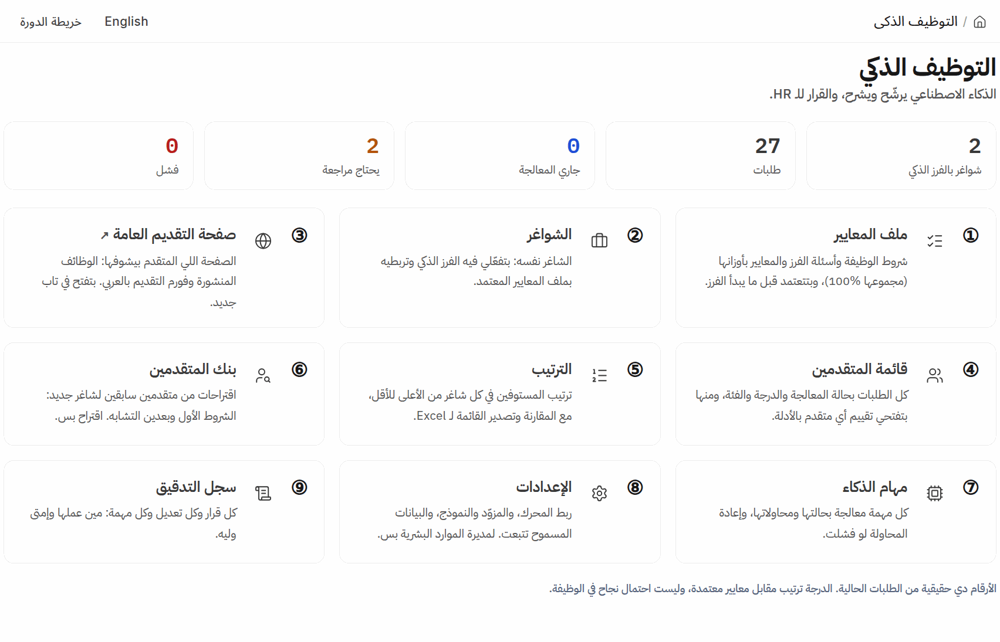

## 02 — ملف المعايير «مشرف أمن — الرياض»

- الرابط: `http://100.85.37.127:18050/desk/ai-job-profile/AI-JP-0002`
- المستخدم: `hr.manager@example.com`
- تدوسي على: الزرار الأول في الرئيسية «ملف المعايير» ثم الملف «مشرف أمن — الرياض»
- النتيجة: الشروط الإلزامية (الجنسية، الطول، الوزن، السن)، وجدول المعايير السبعة بأوزانها (مجموعها 100%)، وأسئلة الفرز، وحالة «معتمد»
- الوقت في البروفة: 8.0 ثانية

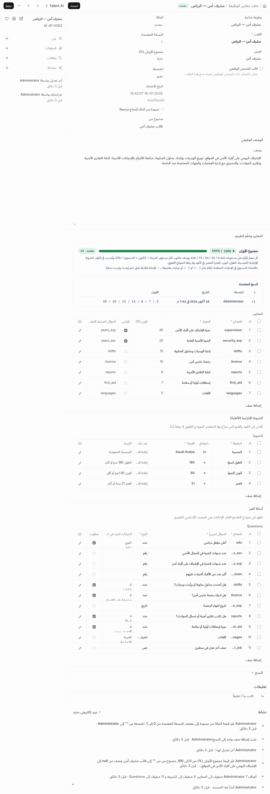

## 03 — صفحة الوظيفة العامة (زي ما المتقدم بيشوفها)

- الرابط: `http://100.85.37.127:18050/jobs/security/security-supervisor-riyadh`
- المستخدم: `زائر (بدون دخول) — افتحيها في نافذة خاصة`
- تدوسي على: من الرئيسية الزرار الثالث «صفحة التقديم العامة» ثم الوظيفة «مشرف أمن — الرياض»
- النتيجة: وصف الوظيفة، ومربع «شروط التقديم» الأربعة، وزرار «قدّم الآن»
- الوقت في البروفة: 5.7 ثانية

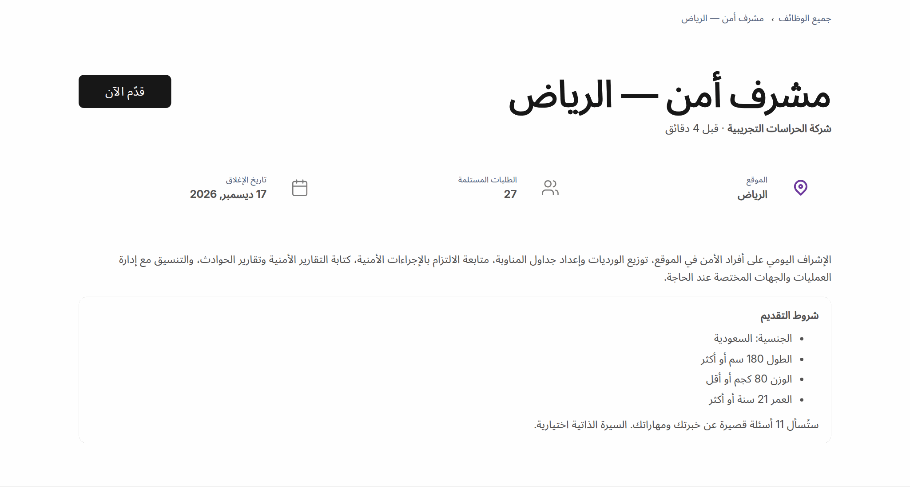

## 04 — نموذج التقديم بسيرة ممسوحة (متقدم جديد)

- الرابط: `http://100.85.37.127:18050/ai-apply/new?job_title=HR-OPN-2026-0001`
- المستخدم: `زائر`
- تدوسي على: «قدّم الآن» ← املي البيانات (الاسم ماجد الشهراني، الإيميل demo.majed@example.com) والأسئلة ← «Choose File» واختاري الصورة الممسوحة ← علّمي «موافقة على المعالجة» ← «إرسال الطلب»
- النتيجة: الطلب اتبعت في 0.75 ثانية ورسالة الشكر ظهرت (الصورة الجاية)
- الوقت في البروفة: 14.5 ثانية

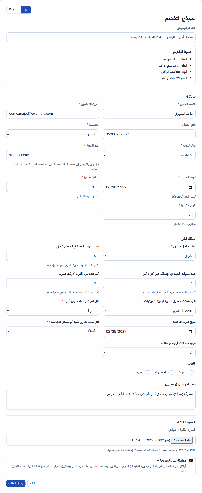

## 05 — رسالة الشكر بعد الإرسال

- الرابط: `نفس الصفحة بعد الإرسال`
- المستخدم: `زائر`
- تدوسي على: لا شيء — بتظهر لوحدها بعد «إرسال الطلب»
- النتيجة: علامة صح، واسم الوظيفة، وجملة إن الموارد البشرية هي اللي هتراجع؛ مفيش أي درجة للمتقدم (الإرسال خد 0.75 ثانية)
- الوقت في البروفة: 0.0 ثانية

## 06 — طلب المتقدم أثناء المعالجة

- الرابط: `http://100.85.37.127:18050/desk/job-applicant/demo.majed@example.com`
- المستخدم: `hr.manager@example.com`
- تدوسي على: من الرئيسية «قائمة المتقدمين» ثم الطلب الجديد (أو افتحي الرابط فورًا بعد الإرسال)
- النتيجة: الحالة «جاري المعالجة» ورسالة «جاري المعالجة… تتحدث هذه الشاشة تلقائيًا عند وصول النتيجة» مكان التقييم؛ أول ما النتيجة توصل (حوالي 40 ثانية للسيرة الممسوحة) كارت التقييم ومراحل المعالجة العشرة بيظهروا لوحدهم من غير تحديث للصفحة
- الوقت في البروفة: 8.7 ثانية

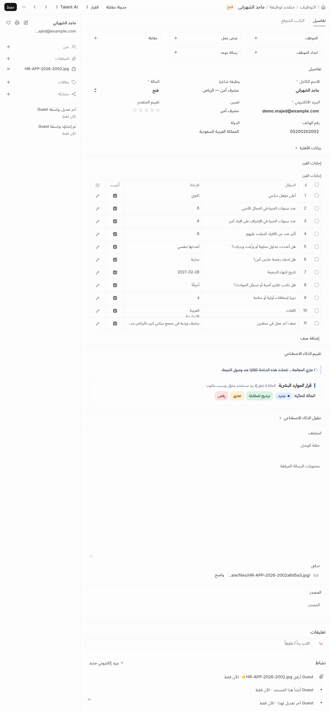

## 07 — تحليل السيرة الممسوحة

- الرابط: `http://100.85.37.127:18050/desk/job-applicant/demo.majed@example.com`
- المستخدم: `hr.manager@example.com`
- تدوسي على: زرار «تحليل السيرة» فوق الطلب (مجموعة Talent AI)
- النتيجة: صورة السيرة وعليها مربعات القراءة بالألوان حسب الثقة، والنص المستخرج سطر سطر، وإخفاء الهوية قبل وبعد (النتيجة ظهرت بعد 41.4 ثانية من الإرسال)
- الوقت في البروفة: 51.4 ثانية

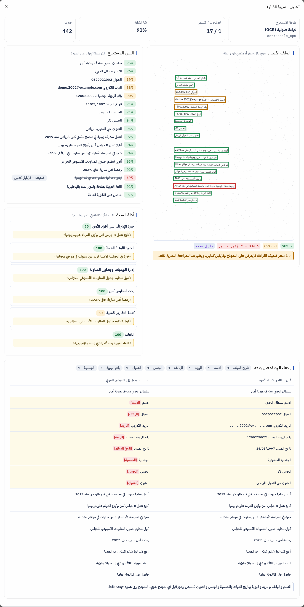

## 08 — شاشة التقييم

- الرابط: `http://100.85.37.127:18050/desk/job-applicant/demo.majed@example.com`
- المستخدم: `hr.manager@example.com`
- تدوسي على: انزلي لقسم «تقييم الذكاء الاصطناعي» في نفس الطلب
- النتيجة: الدرجة والفئة والأهلية، ونقاط القوة والنواقص، وجدول المعايير معيار معيار مع الدليل (إجابة النموذج والجملة من السيرة)، ونص السيرة كما يراه النموذج
- الوقت في البروفة: 7.4 ثانية

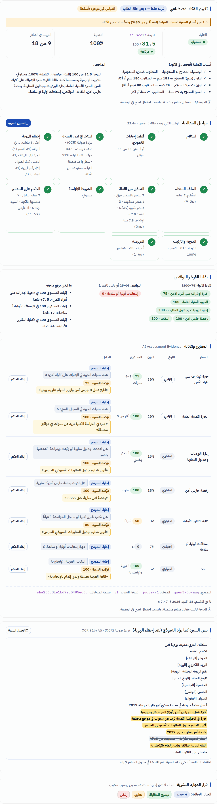

## 09 — الترتيب

- الرابط: `http://100.85.37.127:18050/desk/ai-ranking?opening=HR-OPN-2026-0001`
- المستخدم: `hr.manager@example.com`
- تدوسي على: من الرئيسية الزرار الخامس «الترتيب» واختاري «مشرف أمن — الرياض»
- النتيجة: المستوفين مرتبين من الأعلى للأقل بالدرجة والفئة ونقاط القوة، وتحتهم المجموعات المقفولة (غير مستوفين، يحتاج مراجعة، مكرر، بانتظار الموافقة…)
- الوقت في البروفة: 7.7 ثانية

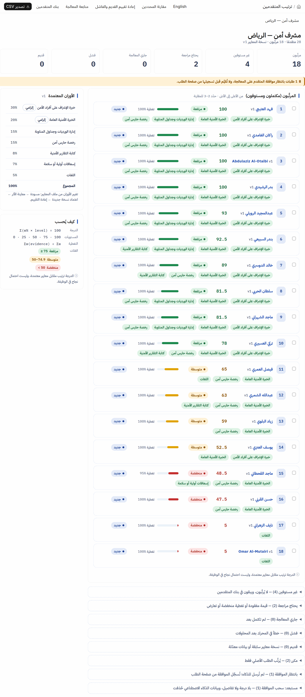

## 10 — مقارنة ثلاثة متقدمين

- الرابط: `http://100.85.37.127:18050/desk/ai-ranking?opening=HR-OPN-2026-0001`
- المستخدم: `hr.manager@example.com`
- تدوسي على: علّمي المربع جنب أول ثلاثة في الترتيب ثم زرار «مقارنة» فوق
- النتيجة: جدول جنب بعض: كل معيار في سطر، ولكل متقدم مستواه ودليله، والدرجة في الآخر
- الوقت في البروفة: 4.6 ثانية

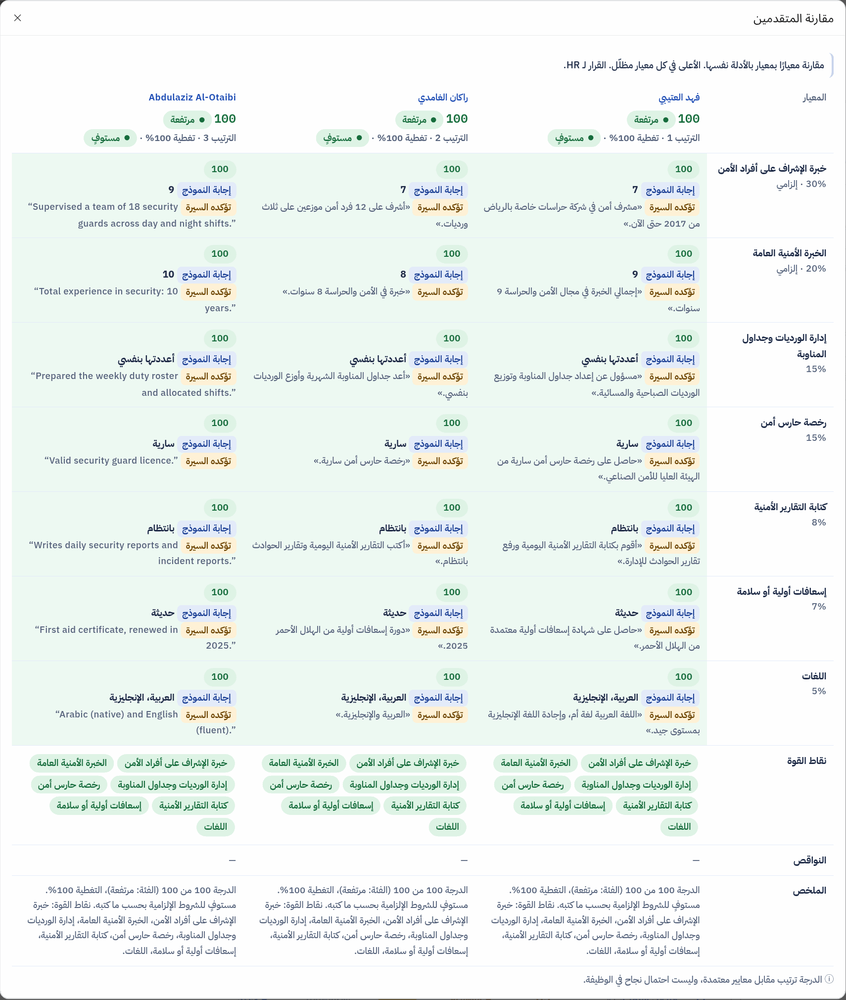

## 11 — قرار الموارد البشرية بسبب

- الرابط: `http://100.85.37.127:18050/desk/job-applicant/demo.majed@example.com`
- المستخدم: `hr.manager@example.com`
- تدوسي على: زرار «ترشيح للمقابلة» (في كارت «قرار الموارد البشرية» أو من قائمة «قرار» فوق) ← اكتبي السبب ← «تأكيد»
- النتيجة: لو السبب فاضي الزرار بيترفض؛ بعد التأكيد الحالة بتتغير والقرار والسبب واسمك والوقت بيتسجلوا
- الوقت في البروفة: 11.0 ثانية

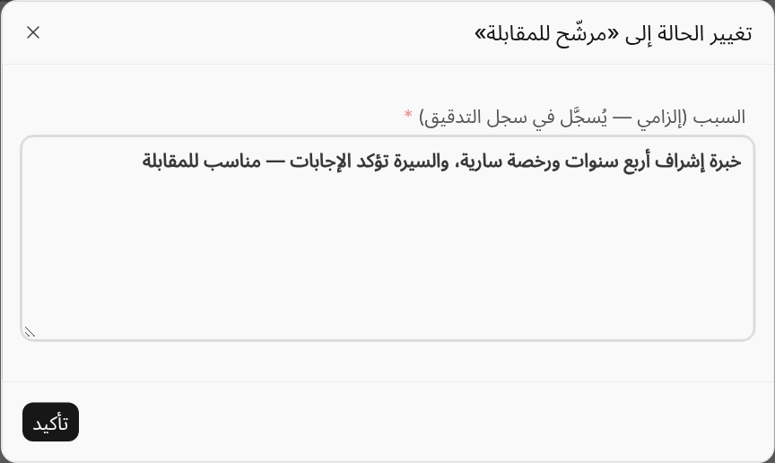

## 12 — القرار بعد التأكيد

- الرابط: `http://100.85.37.127:18050/desk/job-applicant/demo.majed@example.com`
- المستخدم: `hr.manager@example.com`
- تدوسي على: لا شيء — الكارت بيتحدّث بعد التأكيد
- النتيجة: كارت «قرار الموارد البشرية» فيه الحالة الجديدة «Shortlisted» والسبب ومين قرر وإمتى؛ الذكاء ما غيّرش الحالة
- الوقت في البروفة: 7.9 ثانية

## 13 — سجل التدقيق

- الرابط: `http://100.85.37.127:18050/desk/ai-recruitment-audit-log`
- المستخدم: `hr.manager@example.com`
- تدوسي على: من الرئيسية الزرار التاسع «سجل التدقيق»
- النتيجة: آخر الإجراءات فوق: القرار اللي لسه اتاخد بسببه، والتقييم، والمعالجة — كل سطر باسم صاحبه ووقته
- الوقت في البروفة: 6.4 ثانية

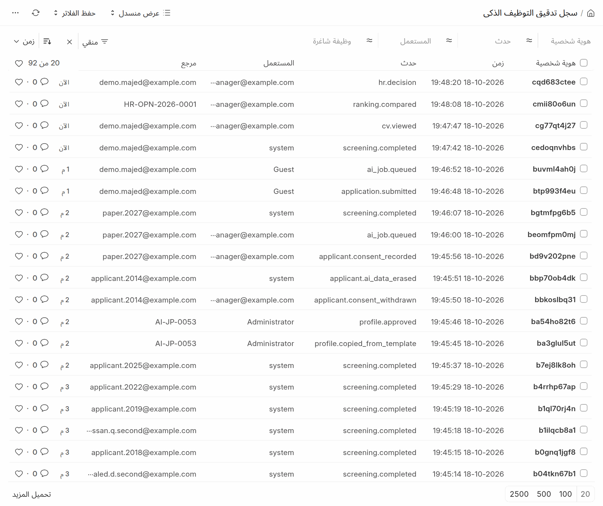

## 14 — الصلاحيات: أخصائي التوظيف يحاول يفتح الإعدادات

- الرابط: `http://100.85.37.127:18050/desk/ai-recruitment-settings`
- المستخدم: `hr.user@example.com`
- تدوسي على: سجّلي الخروج وادخلي بأخصائي التوظيف ثم افتحي الرابط (أو الزرار الثامن «الإعدادات» وهو رمادي)
- النتيجة: رسالة «لا يسمح لك بالوصول إلى هذه الصفحة»؛ الإعدادات والمفاتيح لمدير الموارد البشرية ومدير النظام بس
- الوقت في البروفة: 9.1 ثانية

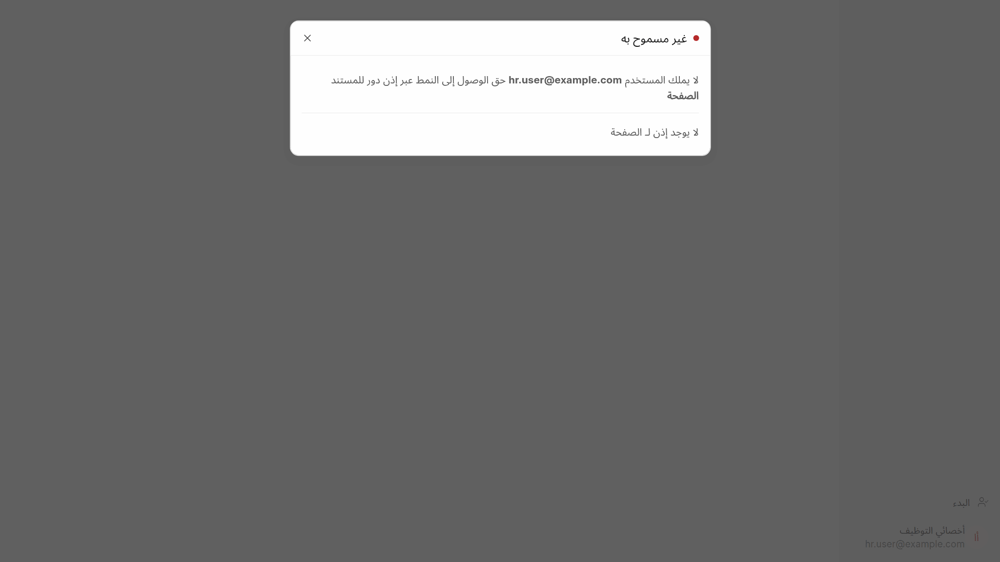

## 15 — حالة المحرك واقف

- الرابط: `http://100.85.37.127:18050/desk/ai-recruitment-settings`
- المستخدم: `hr.manager@example.com`
- تدوسي على: (على السيرفر) `talent-engine/scripts/compose.sh stop api` ثم افتحي الإعدادات؛ وبعد العرض `… start api`
- النتيجة: كارت «حالة المحرك» بيقول إنه غير متاح؛ أي طلب يتقدّم في الوقت ده بيتحفظ عادي وبيتقيّم لما المحرك يرجع (لوحده كل ساعة أو بزرار «إعادة المحاولة»)
- الوقت في البروفة: 123.3 ثانية

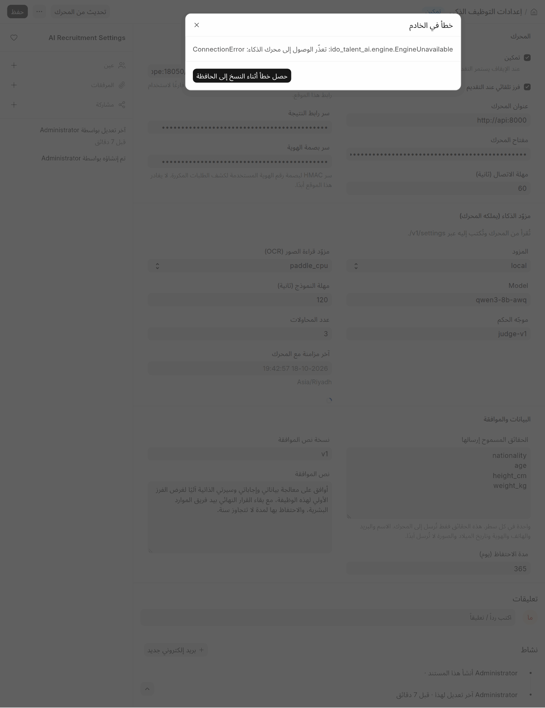
