# Talent AI — full test report (rounds 2 and 3)

Run on the local bench, last update 2026-10-16 15:56:34 (Asia/Riyadh). Synthetic data only.

| | |
|---|---|
| Workspace commit | `5c454db` (`p13-consent`) |
| Frappe app commit | `36cbd62` |
| Platform | Frappe v16.31.0, ERPNext v16.32.0, HRMS develop 640af1592a01 (`dev-frappe/VERSIONS.md`) |
| Engine | FastAPI + 4 RQ workers, Qwen3-8B-AWQ (vLLM, GPU cap 0.40), prompt `judge-v1`, PaddleOCR on CPU, Qwen3-Embedding-0.6B on CPU |
| Browser | Chrome 153 headless driven by Playwright 1.64 for Python (`tools/ui/full_test.py`). The Playwright MCP server was not available in this session, so the same Playwright engine was driven from Python. |
| Result | **40 of 40 checks passed** |

Screenshots are 8-bit PNG under `docs/guide/images/` (they are reused by the guide). Passwords and keys appear nowhere in this report or in the images.

## 1. Bugs found and fixed in rounds 2 and 3

| # | Area | Problem | Fix | Covered by |
|---|---|---|---|---|
| B1 | Application save | A database conflict (MariaDB snapshot isolation, error 1020) during the public form could lose the application. | `api.apply()` saves through a helper with three attempts and checks the row exists before answering. | Frappe `test_application_is_always_saved` (DB conflict case) |
| B2 | Application save | The screening job was queued inside the request, before the commit, so a queue error could roll the application back. | Queued with `frappe.db.after_commit`; a queue error is logged, never raised. | Frappe `test_application_is_always_saved` (queue down at commit) |
| B3 | Application save | A failing audit write could abort the application. | `_safe_audit()` keeps the application and logs the audit error. | Frappe `test_application_is_always_saved` (audit down) |
| B4 | Application save | A damaged CV file raised inside Frappe's File insert. | Savepoint around the attachment; the reason goes to `ai_cv_note`; the application is saved. | Frappe `test_application_is_always_saved` (damaged CV); browser C08 |
| B5 | Home page | HR users landed on the generic desk in English. | «التوظيف الذكي» home page for HR roles; Arabic set for new HR users. | Frappe `test_hr_users_land_on_the_home_page_in_arabic`; browser R08 |
| S1 | Permissions | `profile.templates_for` had no HR check: any logged-in user could list the approved profile templates. | `require_hr()` and a read-permission check. | Frappe `test_every_hr_method_refuses_other_users_first` (fails without the fix) |
| S2 | Permissions (test data) | The demo and test «Employee» users held no role at all: ERPNext removes the Employee roles from a user without an Employee record, so earlier checks tested a user with no role. | Synthetic Employee records for these users (`seed_demo.ensure_employee`); the tests assert the role is held. | Frappe `_employee_user()` assertion; browser R01 |
| S3 | Console | Fonts were served as `application/octet-stream`. | Media types for the static files. | Engine `test_fonts_are_served_locally` |
| F1 | CV files (found by the full test, C05) | An RTF CV ended the screening in «فشل»: Frappe's File.get_content() returns text (str) for text-like files, hashing it failed, and any CV read problem failed the whole job. | The CV is read as raw bytes from disk; a CV the platform cannot read or the engine refuses gives a «ملاحظة عن السيرة الذاتية» and the screening continues from the answers (decision 14); only an engine outage is retried. | Frappe `test_text_cv_is_sent_as_bytes_and_cv_problems_never_fail` (fails without the fix); browser C05 |
| F2 | Re-score all (found by the full test, K14) | «إعادة تقييم الكل» stopped at the first applicant who had withdrawn consent: queue_screening raised and every applicant after him stayed «قديم» (19 of 36 after the new profile version). | Applicants without consent are skipped and counted; one applicant's error never stops the others; the ranking page says how many were skipped. | Frappe `test_withdrawn_consent_stops_processing` (extended; fails without the fix); browser K14 |
| G1 | Job Opening (found while taking the guide screenshots) | The Talent AI section of the opening sat inside the «تفاصيل الراتب» (Pay Details) tab: the custom fields were inserted after «description», which HRMS v16 follows with that tab. | The section is inserted after the application web form route, in the main tab next to the publishing settings. | Frappe `test_ai_section_is_on_the_main_tab_of_the_opening` |
| E1 | Engine erasure (found while building #21) | Deleting a candidate in the engine removed its rows but left the CV file and its preview on the file volume. | Erasure removes the stored files too, after the commit, when no other document uses them. | engine `test_deleting_a_candidate_also_removes_the_cv_file` |
| E2 | Engine files | Replacing or removing a CV deleted the stored file even when another candidate's document held the same file (the same CV uploaded twice), so that candidate's CV pages broke. | Files are content-addressed and now reference-checked: a file goes only with its last document. | engine `test_a_file_shared_by_two_candidates_stays_until_the_last_one_goes` |
| E3 | Developer setup | `make install` was a plain `uv sync`, which removes PaddleOCR, Presidio and spaCy; the two English-name redaction tests then skipped without a word. | `make install` runs `uv sync --group documents`. | `make test` after `make install`: 120 passed, 1 skipped (OCR only) |
| E5 | Safety nets (found while rebuilding the demo) | The 2-minute safety net compared `creation` (stored in the site's time zone, Asia/Riyadh) with SQL `now()` (the database clock, UTC): an application left «Processing» was picked up only three hours later; the batch page's «finished in the last 10 minutes» counted three hours. | Both limits are computed in Python with the site's clock and passed to the query. | Frappe `test_the_safety_nets_read_the_site_clock` (fails with the old query) |
| E4 | Local bench (found while rebuilding the demo) | The app tests left real background jobs, and the test site's scheduler kept queueing screenings of test applicants against an engine address nobody serves: 588 of them filled the shared `long` queue and the demo's screenings waited behind them. | The test class blocks every real enqueue (and drops pending commit callbacks at the end); the test site keeps its scheduler disabled (dev-frappe/README.md). | Frappe suite run with the queue counted before and after: 0 test jobs left |
| D1 | Design | Grey text at 4.13:1 (below WCAG AA 4.5:1) on every screen. | Darker greys (#56627c) and darker chip text. | Design audit (low-contrast count) |
| D2 | Design | Text at 10–11 px (cycle map, sidebar, help texts, KPI labels, code). | Nothing under 12 px. | Design audit (small-font count) |
| D3 | Design | Console ranking: the reference «HR-APP-…» was cut and ran under the score at 1366 px. | The name column wraps; narrower bar under 1440 px. | Design audit 1366/1440 |
| D4 | Design | Desk ranking: strengths stacked and cut in the narrow name column. | Strengths on their own line under each row. | Design audit; screenshots K11 |
| D5 | Design | Processing notes mixed English keys and Arabic in the wrong order («dob 1، name 3»). | Arabic notes from the engine (`app/domain/arabic_text.py`) and bidi isolation of Latin words. | Engine `test_cv_api`, `test_llm`; screenshots C01–C09 |
| D6 | Design | Curly quotes landed on the wrong side of CV quotes in RTL. | «…» around an isolated quote. | Screenshots K05, K08 |
| D7 | Design | Colours without one meaning: red «إلزامي», purple/red duplicate, amber stale, red contradiction and unreadable CV, purple read-only chip. | Green = eligible/high, amber = medium/needs review, red = not eligible/low/failed, grey = stale/duplicate, blue = information, purple = an HR edit. | Screenshots K04–K07 |
| D8 | Design | Evaluation dates inside `<code>` were garbled in RTL. | Readable Arabic dates, isolated. | Screenshots |
| D9 | Design | HRMS recruitment labels in English (87 strings) and the grid's «No.» shown as «لا». | Arabic translations in the app (`translations/ar.csv`). | Screenshots R and K |
| D10 | Design | The applicant list's ID column showed «com». | `hide_name_column` (the e-mail has its own column). | Screenshot roles/hr_manager_list |
| D11 | Design | Answers grid: the technical key column was cut («…rs_sec»). | Key hidden in the grid; question and answer wider. | Screenshots C01 |
| D12 | Design / privacy | Every page loaded the fonts from Google (a third-party call with the user's IP). | IBM Plex Sans Arabic and IBM Plex Mono served by the app (OFL licence). | Engine `test_fonts_are_served_locally` |
| D13 | Design | Raw method names and redaction keys («pdf_text», «name 3») on HR screens. | Arabic labels («نص PDF مباشر», «الاسم (3)»). | Screenshots C01–C09 |
| D14 | Design | The same CSS block was repeated four times in both stylesheets. | One copy. | — |
| D15 | Design | Console audit log: the JSON payload overflowed into the next cells. | The payload wraps inside its cell. | Design audit (overlap count) |
| D16 | Design | Console criteria editor: «إلزامي» broken letter by letter, Arabic hints in a monospace font (disconnected letters), delete buttons cut at 1366 px. | No-wrap label, Arabic font for Arabic hints, narrower columns. | Design audit 1366 |
| D17 | Design | Public job pages (HRMS): grey text below AA, 11 px labels, «Closes on:» and «Showing» in English. | A scoped web stylesheet (`talent_ai_web.css`) and translations; the HRMS templates are untouched. | Design audit public pages |
| D18 | Design | Cycle-map arrows at 1.46:1. | 3.9:1. | Design audit |
| D19 | Design (found in the roles screenshots) | This round's `overflow-wrap: anywhere` on table cells let a narrow column shrink to one letter: the labels of the «حالة المحرك» card in the settings broke letter by letter next to a long URL. | `overflow-wrap: break-word` on cells (long words still break, columns are not squeezed); codes and URLs still break anywhere. The audit now reports squeezed text (three or more lines of under three characters). | Design audit (squeezed-text); settings screenshots retaken |
| D20 | Design | A quote from an English CV took the Arabic «» marks, which landed on the wrong sides when the quote wrapped. | English quotes keep English marks “…” inside their own left-to-right block; Arabic quotes keep «…». | Screenshot K11 / guide comparison |

## 2. Roles and permissions

Roles on the local site: 52. Recruitment-related roles tested: Administrator, System Manager, HR Manager, HR User, Interviewer, Employee, Employee Self Service, Guest, Website User (no role).

No «Hiring Manager» or department-manager role exists in Frappe HR v16 (checked the full role list); a hiring manager is an Employee who may also be an Interviewer.

| User | Login | Roles |
|---|---|---|
| Administrator | `Administrator` | Administrator (كل الصلاحيات) |
| مدير النظام | `sysmanager@example.com` | System Manager |
| مدير الموارد البشرية | `hr.manager@example.com` | HR Manager, HR User, Employee |
| أخصائي التوظيف | `hr.user@example.com` | HR User, Employee |
| المقابِل | `interviewer@example.com` | Interviewer, Employee |
| موظف | `employee@example.com` | Employee |
| موظف خدمة ذاتية | `ess@example.com` | Employee Self Service, Employee |
| متقدم بحساب على الموقع | `portal.applicant@example.com` | Website User |
| زائر / متقدم بلا حساب | `Guest` | Guest |

Passwords of the test users are in `dev-frappe/.env` (never committed).

### 2.1 What each user sees (screens × users)

يشوف = sees it, read only · يعدّل = sees it and can act · ممنوع = refused (Frappe message or the login page).

| Screen | Administrator | مدير النظام | مدير الموارد البشرية | أخصائي التوظيف | المقابِل | موظف | موظف خدمة ذاتية | متقدم بحساب على الموقع | زائر / متقدم بلا حساب |
|---|---|---|---|---|---|---|---|---|---|
| الصفحة الرئيسية «التوظيف الذكي» | يشوف | يشوف | يشوف | يشوف | ممنوع | ممنوع | ممنوع | ممنوع | ممنوع |
| خريطة الدورة | يشوف | يشوف | يشوف | يشوف | ممنوع | ممنوع | ممنوع | ممنوع | ممنوع |
| ملف المعايير | يعدّل | يعدّل | يعدّل | يعدّل | ممنوع | ممنوع | ممنوع | ممنوع | ممنوع |
| الشاغر | يعدّل | يعدّل | يعدّل | يعدّل | ممنوع | ممنوع | ممنوع | ممنوع | ممنوع |
| قائمة المتقدمين | يعدّل | يعدّل | يعدّل | يعدّل | ممنوع | ممنوع | ممنوع | ممنوع | ممنوع |
| طلب المتقدم | يعدّل | يعدّل | يعدّل | يعدّل | ممنوع | ممنوع | ممنوع | ممنوع | ممنوع |
| قسم تقييم الذكاء | يعدّل | يعدّل | يعدّل | يعدّل | ممنوع | ممنوع | ممنوع | ممنوع | ممنوع |
| تحليل السيرة | يشوف | يشوف | يشوف | يشوف | ممنوع | ممنوع | ممنوع | ممنوع | ممنوع |
| ملف السيرة الأصلي | يشوف | يشوف | يشوف | يشوف | ممنوع | ممنوع | ممنوع | ممنوع | ممنوع |
| الترتيب | يعدّل | يعدّل | يعدّل | يعدّل | ممنوع | ممنوع | ممنوع | ممنوع | ممنوع |
| متابعة الدفعة | يعدّل | يعدّل | يعدّل | يعدّل | ممنوع | ممنوع | ممنوع | ممنوع | ممنوع |
| بنك المتقدمين | يشوف | يشوف | يشوف | يشوف | ممنوع | ممنوع | ممنوع | ممنوع | ممنوع |
| مهام الذكاء | يشوف | يشوف | يشوف | يشوف | ممنوع | ممنوع | ممنوع | ممنوع | ممنوع |
| الإعدادات | يعدّل | يعدّل | يعدّل | ممنوع | ممنوع | ممنوع | ممنوع | ممنوع | ممنوع |
| سجل التدقيق | يشوف | يشوف | يشوف | يشوف | ممنوع | ممنوع | ممنوع | ممنوع | ممنوع |
| صفحة التقديم العامة | يعدّل | يعدّل | يعدّل | يعدّل | يعدّل | يعدّل | يعدّل | يعدّل | يعدّل |
| Talent Console | ممنوع | ممنوع | ممنوع | ممنوع | ممنوع | ممنوع | ممنوع | ممنوع | ممنوع |

Details and the screenshot of every cell (denial messages included):

Administrator (<code>Administrator</code>)

| Screen | Result | Detail | Screenshot |
|---|---|---|---|
| الصفحة الرئيسية «التوظيف الذكي» | يشوف | actions: English · خريطة الدورة | [png](guide/images/roles/administrator_home.png) |
| خريطة الدورة | يشوف | actions: English | [png](guide/images/roles/administrator_cycle.png) |
| ملف المعايير | يعدّل | can edit | [png](guide/images/roles/administrator_profile.png) |
| الشاغر | يعدّل | can edit | [png](guide/images/roles/administrator_opening.png) |
| قائمة المتقدمين | يعدّل | 20 rows; AI columns: حالة المعالجة (AI), درجة الذكاء | [png](guide/images/roles/administrator_list.png) |
| طلب المتقدم | يعدّل | can edit the form | [png](guide/images/roles/administrator_applicant.png) |
| قسم تقييم الذكاء | يعدّل | decision buttons «القرار» + override | [png](guide/images/roles/administrator_assessment.png) |
| تحليل السيرة | يشوف | dialog with the page image and OCR boxes | [png](guide/images/roles/administrator_cv_analysis.png) |
| ملف السيرة الأصلي | يشوف | HTTP 200 |  |
| الترتيب | يعدّل | actions: English · مقارنة المحددين · إعادة تقييم القديم والفاشل · متابعة المعالجة · بنك المتقدمين · تصدير CSV | [png](guide/images/roles/administrator_ranking.png) |
| متابعة الدفعة | يعدّل | actions: English · ترتيب الشاغر · مهام الذكاء | [png](guide/images/roles/administrator_batch.png) |
| بنك المتقدمين | يشوف | actions: English · ترتيب الشاغر · بحث في بنك المتقدمين | [png](guide/images/roles/administrator_pool.png) |
| مهام الذكاء | يشوف | 20 rows | [png](guide/images/roles/administrator_jobs.png) |
| الإعدادات | يعدّل | can edit | [png](guide/images/roles/administrator_settings.png) |
| سجل التدقيق | يشوف | 20 rows | [png](guide/images/roles/administrator_audit.png) |
| صفحة التقديم العامة | يعدّل | public form (anyone can apply) | [png](guide/images/roles/administrator_public_form.png) |
| Talent Console | ممنوع | separate login; only the console user (Nadine) has an account |  |

مدير النظام (<code>sysmanager@example.com</code>)

| Screen | Result | Detail | Screenshot |
|---|---|---|---|
| الصفحة الرئيسية «التوظيف الذكي» | يشوف | actions: English · خريطة الدورة | [png](guide/images/roles/system_manager_home.png) |
| خريطة الدورة | يشوف | actions: English | [png](guide/images/roles/system_manager_cycle.png) |
| ملف المعايير | يعدّل | can edit | [png](guide/images/roles/system_manager_profile.png) |
| الشاغر | يعدّل | can edit | [png](guide/images/roles/system_manager_opening.png) |
| قائمة المتقدمين | يعدّل | 20 rows; AI columns: حالة المعالجة (AI), درجة الذكاء | [png](guide/images/roles/system_manager_list.png) |
| طلب المتقدم | يعدّل | can edit the form | [png](guide/images/roles/system_manager_applicant.png) |
| قسم تقييم الذكاء | يعدّل | decision buttons «القرار» + override | [png](guide/images/roles/system_manager_assessment.png) |
| تحليل السيرة | يشوف | dialog with the page image and OCR boxes | [png](guide/images/roles/system_manager_cv_analysis.png) |
| ملف السيرة الأصلي | يشوف | HTTP 200 |  |
| الترتيب | يعدّل | actions: English · مقارنة المحددين · إعادة تقييم القديم والفاشل · متابعة المعالجة · بنك المتقدمين · تصدير CSV | [png](guide/images/roles/system_manager_ranking.png) |
| متابعة الدفعة | يعدّل | actions: English · ترتيب الشاغر · مهام الذكاء | [png](guide/images/roles/system_manager_batch.png) |
| بنك المتقدمين | يشوف | actions: English · ترتيب الشاغر · بحث في بنك المتقدمين | [png](guide/images/roles/system_manager_pool.png) |
| مهام الذكاء | يشوف | 20 rows | [png](guide/images/roles/system_manager_jobs.png) |
| الإعدادات | يعدّل | can edit | [png](guide/images/roles/system_manager_settings.png) |
| سجل التدقيق | يشوف | 20 rows | [png](guide/images/roles/system_manager_audit.png) |
| صفحة التقديم العامة | يعدّل | public form (anyone can apply) | [png](guide/images/roles/system_manager_public_form.png) |
| Talent Console | ممنوع | separate login; only the console user (Nadine) has an account |  |

مدير الموارد البشرية (<code>hr.manager@example.com</code>)

| Screen | Result | Detail | Screenshot |
|---|---|---|---|
| الصفحة الرئيسية «التوظيف الذكي» | يشوف | actions: English · خريطة الدورة | [png](guide/images/roles/hr_manager_home.png) |
| خريطة الدورة | يشوف | actions: English | [png](guide/images/roles/hr_manager_cycle.png) |
| ملف المعايير | يعدّل | can edit | [png](guide/images/roles/hr_manager_profile.png) |
| الشاغر | يعدّل | can edit | [png](guide/images/roles/hr_manager_opening.png) |
| قائمة المتقدمين | يعدّل | 20 rows; AI columns: حالة المعالجة (AI), درجة الذكاء | [png](guide/images/roles/hr_manager_list.png) |
| طلب المتقدم | يعدّل | can edit the form | [png](guide/images/roles/hr_manager_applicant.png) |
| قسم تقييم الذكاء | يعدّل | decision buttons «القرار» + override | [png](guide/images/roles/hr_manager_assessment.png) |
| تحليل السيرة | يشوف | dialog with the page image and OCR boxes | [png](guide/images/roles/hr_manager_cv_analysis.png) |
| ملف السيرة الأصلي | يشوف | HTTP 200 |  |
| الترتيب | يعدّل | actions: English · مقارنة المحددين · إعادة تقييم القديم والفاشل · متابعة المعالجة · بنك المتقدمين · تصدير CSV | [png](guide/images/roles/hr_manager_ranking.png) |
| متابعة الدفعة | يعدّل | actions: English · ترتيب الشاغر · مهام الذكاء | [png](guide/images/roles/hr_manager_batch.png) |
| بنك المتقدمين | يشوف | actions: English · ترتيب الشاغر · بحث في بنك المتقدمين | [png](guide/images/roles/hr_manager_pool.png) |
| مهام الذكاء | يشوف | 20 rows | [png](guide/images/roles/hr_manager_jobs.png) |
| الإعدادات | يعدّل | can edit | [png](guide/images/roles/hr_manager_settings.png) |
| سجل التدقيق | يشوف | 20 rows | [png](guide/images/roles/hr_manager_audit.png) |
| صفحة التقديم العامة | يعدّل | public form (anyone can apply) | [png](guide/images/roles/hr_manager_public_form.png) |
| Talent Console | ممنوع | separate login; only the console user (Nadine) has an account |  |

أخصائي التوظيف (<code>hr.user@example.com</code>)

| Screen | Result | Detail | Screenshot |
|---|---|---|---|
| الصفحة الرئيسية «التوظيف الذكي» | يشوف | 1 card(s) shown as «غير متاح لدورك» | [png](guide/images/roles/hr_user_home.png) |
| خريطة الدورة | يشوف | actions: English | [png](guide/images/roles/hr_user_cycle.png) |
| ملف المعايير | يعدّل | can edit | [png](guide/images/roles/hr_user_profile.png) |
| الشاغر | يعدّل | can edit | [png](guide/images/roles/hr_user_opening.png) |
| قائمة المتقدمين | يعدّل | 20 rows; AI columns: حالة المعالجة (AI), درجة الذكاء | [png](guide/images/roles/hr_user_list.png) |
| طلب المتقدم | يعدّل | can edit the form | [png](guide/images/roles/hr_user_applicant.png) |
| قسم تقييم الذكاء | يعدّل | decision buttons «القرار» + override | [png](guide/images/roles/hr_user_assessment.png) |
| تحليل السيرة | يشوف | dialog with the page image and OCR boxes | [png](guide/images/roles/hr_user_cv_analysis.png) |
| ملف السيرة الأصلي | يشوف | HTTP 200 |  |
| الترتيب | يعدّل | actions: English · مقارنة المحددين · إعادة تقييم القديم والفاشل · متابعة المعالجة · بنك المتقدمين · تصدير CSV | [png](guide/images/roles/hr_user_ranking.png) |
| متابعة الدفعة | يعدّل | actions: English · ترتيب الشاغر · مهام الذكاء | [png](guide/images/roles/hr_user_batch.png) |
| بنك المتقدمين | يشوف | actions: English · ترتيب الشاغر · بحث في بنك المتقدمين | [png](guide/images/roles/hr_user_pool.png) |
| مهام الذكاء | يشوف | 20 rows | [png](guide/images/roles/hr_user_jobs.png) |
| الإعدادات | ممنوع | Frappe: البدء | [png](guide/images/roles/hr_user_settings.png) |
| سجل التدقيق | يشوف | 20 rows | [png](guide/images/roles/hr_user_audit.png) |
| صفحة التقديم العامة | يعدّل | public form (anyone can apply) | [png](guide/images/roles/hr_user_public_form.png) |
| Talent Console | ممنوع | separate login; only the console user (Nadine) has an account |  |

المقابِل (<code>interviewer@example.com</code>)

| Screen | Result | Detail | Screenshot |
|---|---|---|---|
| الصفحة الرئيسية «التوظيف الذكي» | ممنوع | Frappe: البدء | [png](guide/images/roles/interviewer_home.png) |
| خريطة الدورة | ممنوع | Frappe: البدء | [png](guide/images/roles/interviewer_home.png) |
| ملف المعايير | ممنوع | Frappe: البدء | [png](guide/images/roles/interviewer_profile.png) |
| الشاغر | ممنوع | Frappe: البدء | [png](guide/images/roles/interviewer_profile.png) |
| قائمة المتقدمين | ممنوع | Frappe: البدء | [png](guide/images/roles/interviewer_profile.png) |
| طلب المتقدم | ممنوع | Frappe: البدء | [png](guide/images/roles/interviewer_profile.png) |
| قسم تقييم الذكاء | ممنوع | Frappe: البدء | [png](guide/images/roles/interviewer_profile.png) |
| تحليل السيرة | ممنوع | API HTTP 403 | [png](guide/images/roles/interviewer_profile.png) |
| ملف السيرة الأصلي | ممنوع | HTTP 403 |  |
| الترتيب | ممنوع | Frappe: البدء | [png](guide/images/roles/interviewer_home.png) |
| متابعة الدفعة | ممنوع | Frappe: البدء | [png](guide/images/roles/interviewer_home.png) |
| بنك المتقدمين | ممنوع | Frappe: البدء | [png](guide/images/roles/interviewer_home.png) |
| مهام الذكاء | ممنوع | Frappe: البدء | [png](guide/images/roles/interviewer_profile.png) |
| الإعدادات | ممنوع | Frappe: البدء | [png](guide/images/roles/interviewer_profile.png) |
| سجل التدقيق | ممنوع | Frappe: البدء | [png](guide/images/roles/interviewer_profile.png) |
| صفحة التقديم العامة | يعدّل | public form (anyone can apply) | [png](guide/images/roles/interviewer_public_form.png) |
| Talent Console | ممنوع | separate login; only the console user (Nadine) has an account |  |

موظف (<code>employee@example.com</code>)

| Screen | Result | Detail | Screenshot |
|---|---|---|---|
| الصفحة الرئيسية «التوظيف الذكي» | ممنوع | Frappe: البدء | [png](guide/images/roles/employee_home.png) |
| خريطة الدورة | ممنوع | Frappe: البدء | [png](guide/images/roles/employee_home.png) |
| ملف المعايير | ممنوع | Frappe: البدء | [png](guide/images/roles/employee_profile.png) |
| الشاغر | ممنوع | Frappe: البدء | [png](guide/images/roles/employee_profile.png) |
| قائمة المتقدمين | ممنوع | Frappe: البدء | [png](guide/images/roles/employee_profile.png) |
| طلب المتقدم | ممنوع | Frappe: البدء | [png](guide/images/roles/employee_profile.png) |
| قسم تقييم الذكاء | ممنوع | Frappe: البدء | [png](guide/images/roles/employee_profile.png) |
| تحليل السيرة | ممنوع | API HTTP 403 | [png](guide/images/roles/employee_profile.png) |
| ملف السيرة الأصلي | ممنوع | HTTP 403 |  |
| الترتيب | ممنوع | Frappe: البدء | [png](guide/images/roles/employee_home.png) |
| متابعة الدفعة | ممنوع | Frappe: البدء | [png](guide/images/roles/employee_home.png) |
| بنك المتقدمين | ممنوع | Frappe: البدء | [png](guide/images/roles/employee_home.png) |
| مهام الذكاء | ممنوع | Frappe: البدء | [png](guide/images/roles/employee_profile.png) |
| الإعدادات | ممنوع | Frappe: البدء | [png](guide/images/roles/employee_profile.png) |
| سجل التدقيق | ممنوع | Frappe: البدء | [png](guide/images/roles/employee_profile.png) |
| صفحة التقديم العامة | يعدّل | public form (anyone can apply) | [png](guide/images/roles/employee_public_form.png) |
| Talent Console | ممنوع | separate login; only the console user (Nadine) has an account |  |

موظف خدمة ذاتية (<code>ess@example.com</code>)

| Screen | Result | Detail | Screenshot |
|---|---|---|---|
| الصفحة الرئيسية «التوظيف الذكي» | ممنوع | Frappe: البدء | [png](guide/images/roles/ess_home.png) |
| خريطة الدورة | ممنوع | Frappe: البدء | [png](guide/images/roles/ess_home.png) |
| ملف المعايير | ممنوع | Frappe: البدء | [png](guide/images/roles/ess_profile.png) |
| الشاغر | ممنوع | Frappe: البدء | [png](guide/images/roles/ess_profile.png) |
| قائمة المتقدمين | ممنوع | Frappe: البدء | [png](guide/images/roles/ess_profile.png) |
| طلب المتقدم | ممنوع | Frappe: البدء | [png](guide/images/roles/ess_profile.png) |
| قسم تقييم الذكاء | ممنوع | Frappe: البدء | [png](guide/images/roles/ess_profile.png) |
| تحليل السيرة | ممنوع | API HTTP 403 | [png](guide/images/roles/ess_profile.png) |
| ملف السيرة الأصلي | ممنوع | HTTP 403 |  |
| الترتيب | ممنوع | Frappe: البدء | [png](guide/images/roles/ess_home.png) |
| متابعة الدفعة | ممنوع | Frappe: البدء | [png](guide/images/roles/ess_home.png) |
| بنك المتقدمين | ممنوع | Frappe: البدء | [png](guide/images/roles/ess_home.png) |
| مهام الذكاء | ممنوع | Frappe: البدء | [png](guide/images/roles/ess_profile.png) |
| الإعدادات | ممنوع | Frappe: البدء | [png](guide/images/roles/ess_profile.png) |
| سجل التدقيق | ممنوع | Frappe: البدء | [png](guide/images/roles/ess_profile.png) |
| صفحة التقديم العامة | يعدّل | public form (anyone can apply) | [png](guide/images/roles/ess_public_form.png) |
| Talent Console | ممنوع | separate login; only the console user (Nadine) has an account |  |

متقدم بحساب على الموقع (<code>portal.applicant@example.com</code>)

| Screen | Result | Detail | Screenshot |
|---|---|---|---|
| الصفحة الرئيسية «التوظيف الذكي» | ممنوع | Frappe: لا يسمح | [png](guide/images/roles/portal_home.png) |
| خريطة الدورة | ممنوع | Frappe: لا يسمح | [png](guide/images/roles/portal_home.png) |
| ملف المعايير | ممنوع | Frappe: لا يسمح | [png](guide/images/roles/portal_home.png) |
| الشاغر | ممنوع | Frappe: لا يسمح | [png](guide/images/roles/portal_home.png) |
| قائمة المتقدمين | ممنوع | Frappe: لا يسمح | [png](guide/images/roles/portal_home.png) |
| طلب المتقدم | ممنوع | Frappe: لا يسمح | [png](guide/images/roles/portal_home.png) |
| قسم تقييم الذكاء | ممنوع | Frappe: لا يسمح | [png](guide/images/roles/portal_home.png) |
| تحليل السيرة | ممنوع | API HTTP 403 | [png](guide/images/roles/portal_home.png) |
| ملف السيرة الأصلي | ممنوع | HTTP 403 |  |
| الترتيب | ممنوع | Frappe: لا يسمح | [png](guide/images/roles/portal_home.png) |
| متابعة الدفعة | ممنوع | Frappe: لا يسمح | [png](guide/images/roles/portal_home.png) |
| بنك المتقدمين | ممنوع | Frappe: لا يسمح | [png](guide/images/roles/portal_home.png) |
| مهام الذكاء | ممنوع | Frappe: لا يسمح | [png](guide/images/roles/portal_home.png) |
| الإعدادات | ممنوع | Frappe: لا يسمح | [png](guide/images/roles/portal_home.png) |
| سجل التدقيق | ممنوع | Frappe: لا يسمح | [png](guide/images/roles/portal_home.png) |
| صفحة التقديم العامة | يعدّل | public form (anyone can apply) | [png](guide/images/roles/portal_public_form.png) |
| Talent Console | ممنوع | separate login; only the console user (Nadine) has an account |  |

زائر / متقدم بلا حساب (<code>Guest</code>)

| Screen | Result | Detail | Screenshot |
|---|---|---|---|
| الصفحة الرئيسية «التوظيف الذكي» | ممنوع | redirected to the login page | [png](guide/images/roles/guest_home.png) |
| خريطة الدورة | ممنوع | redirected to the login page | [png](guide/images/roles/guest_home.png) |
| ملف المعايير | ممنوع | redirected to the login page | [png](guide/images/roles/guest_home.png) |
| الشاغر | ممنوع | redirected to the login page | [png](guide/images/roles/guest_home.png) |
| قائمة المتقدمين | ممنوع | redirected to the login page | [png](guide/images/roles/guest_home.png) |
| طلب المتقدم | ممنوع | redirected to the login page | [png](guide/images/roles/guest_home.png) |
| قسم تقييم الذكاء | ممنوع | redirected to the login page | [png](guide/images/roles/guest_home.png) |
| تحليل السيرة | ممنوع | API HTTP 403 | [png](guide/images/roles/guest_home.png) |
| ملف السيرة الأصلي | ممنوع | HTTP 403 |  |
| الترتيب | ممنوع | redirected to the login page | [png](guide/images/roles/guest_home.png) |
| متابعة الدفعة | ممنوع | redirected to the login page | [png](guide/images/roles/guest_home.png) |
| بنك المتقدمين | ممنوع | redirected to the login page | [png](guide/images/roles/guest_home.png) |
| مهام الذكاء | ممنوع | redirected to the login page | [png](guide/images/roles/guest_home.png) |
| الإعدادات | ممنوع | redirected to the login page | [png](guide/images/roles/guest_home.png) |
| سجل التدقيق | ممنوع | redirected to the login page | [png](guide/images/roles/guest_home.png) |
| صفحة التقديم العامة | يعدّل | public form (anyone can apply) | [png](guide/images/roles/guest_public_form.png) |
| Talent Console | ممنوع | separate login; only the console user (Nadine) has an account |  |

### 2.2 Server-side checks (HTTP status per call)

Each call was made from the user's own browser session. 200 = allowed; 403 = refused; 417 = allowed past the permission check and stopped by validation (the probe sends an invalid status or an empty reason, so nothing changes); 404 = allowed, the probe record does not exist.

| Call | Administrator | مدير النظام | مدير الموارد البشرية | أخصائي التوظيف | المقابِل | موظف | موظف خدمة ذاتية | متقدم بحساب على الموقع | زائر / متقدم بلا حساب |
|---|---|---|---|---|---|---|---|---|---|
| `get_assessment` | 200 | 200 | 200 | 200 | 403 | 403 | 403 | 403 | 403 |
| `ranking` | 200 | 200 | 200 | 200 | 403 | 403 | 403 | 403 | 403 |
| `cv_analysis` | 200 | 200 | 200 | 200 | 403 | 403 | 403 | 403 | 403 |
| `talent_pool` | 200 | 200 | 200 | 200 | 403 | 403 | 403 | 403 | 403 |
| `compare` | 200 | 200 | 200 | 200 | 403 | 403 | 403 | 403 | 403 |
| `export_csv` | 200 | 200 | 200 | 200 | 403 | 403 | 403 | 403 | 403 |
| `decide` | 417 | 417 | 417 | 417 | 403 | 403 | 403 | 403 | 403 |
| `override` | 417 | 417 | 417 | 417 | 403 | 403 | 403 | 403 | 403 |
| `rescreen` | 404 | 404 | 404 | 404 | 403 | 403 | 403 | 403 | 403 |
| `rest_applicant` | 200 (AI fields in the reply; national ID in the reply) | 200 (AI fields in the reply; national ID in the reply) | 200 (AI fields in the reply; national ID in the reply) | 200 (AI fields in the reply; national ID in the reply) | 403 | 403 | 403 | 403 | 403 |
| `rest_assessment` | 200 | 200 | 200 | 200 | 403 | 403 | 403 | 403 | 403 |
| `rest_audit` | 200 | 200 | 200 | 200 | 403 | 403 | 403 | 403 | 403 |
| `rest_settings` | 200 (secrets masked) | 200 (secrets masked) | 200 (secrets masked) | 403 | 403 | 403 | 403 | 403 | 403 |
| `cv_file` | 200 | 200 | 200 | 200 | 403 | 403 | 403 | 403 | 403 |

## 3. Roles: landing page and isolation

### R01 — Employee, Interviewer, self-service, website user and guest never see a score, an assessment or a CV ✅

| | |
|---|---|
| User | interviewer, employee, ess, portal, guest |
| Expected | every AI screen and API call refused (403 or login page) |
| Actual | screens open: none; API 200: none |

### R02 — HR Manager, HR User, System Manager and Administrator see the assessment with the decision buttons ✅

| | |
|---|---|
| User | administrator, system_manager, hr_manager, hr_user |
| Expected | assessment section + «القرار» buttons |
| Actual | administrator: edit; system_manager: edit; hr_manager: edit; hr_user: edit |

### R03 — Shortlist / reject / override are HR-only (server side) ✅

| | |
|---|---|
| User | all |
| Expected | HR: the call passes the permission check and stops at validation (417); others: 403 |
| Actual | administrator: decide 417, override 417; system_manager: decide 417, override 417; hr_manager: decide 417, override 417; hr_user: decide 417, override 417; interviewer: decide 403, override 403; employee: decide 403, override 403; ess: decide 403, override 403; portal: decide 403, override 403; guest: decide 403, override 403 |

### R04 — Settings: HR Manager and System Manager edit, HR User is refused ✅

| | |
|---|---|
| User | hr_manager, hr_user |
| Expected | HR Manager edit; HR User denied |
| Actual | HR Manager edit; HR User deny |

### R05 — HRMS's own Shortlist/Reject buttons (no reason) are replaced by «القرار» ✅

| | |
|---|---|
| User | administrator, system_manager, hr_manager, hr_user |
| Expected | no Shortlist/Reject outside «القرار» |
| Actual | visible for: nobody |

### R06 — The REST API gives HR the AI fields and refuses everyone else ✅

| | |
|---|---|
| User | all |
| Expected | HR 200, others 403 |
| Actual | administrator: 200; system_manager: 200; hr_manager: 200; hr_user: 200; interviewer: 403; employee: 403; ess: 403; portal: 403; guest: 403 |

### R07 — Settings read through the API never show the secrets ✅

| | |
|---|---|
| User | hr_manager |
| Expected | API key and secrets masked |
| Actual | HTTP 200, secrets masked |

### R08_hr_manager — hr_manager lands on «التوظيف الذكي» in Arabic after the login form ✅

| | |
|---|---|
| User | hr.manager@example.com |
| Expected | /desk/ai-recruitment, language ar |
| Actual | /desk/ai-recruitment, language ar, 2.97s |
| Time | 2.97 s |

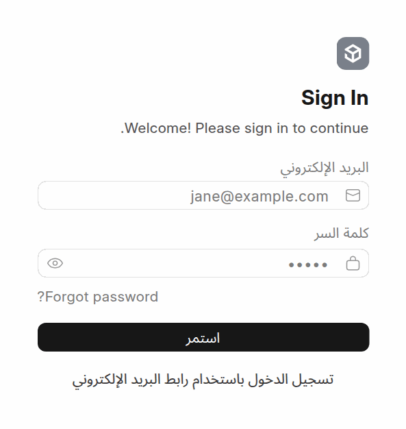

All screenshots: [R08_hr_manager_login.png](guide/images/test/R08_hr_manager_login.png) · [R08_hr_manager_home.png](guide/images/test/R08_hr_manager_home.png)

### R08_hr_user — hr_user lands on «التوظيف الذكي» in Arabic after the login form ✅

| | |
|---|---|
| User | hr.user@example.com |
| Expected | /desk/ai-recruitment, language ar |
| Actual | /desk/ai-recruitment, language ar, 3.59s |
| Time | 3.59 s |

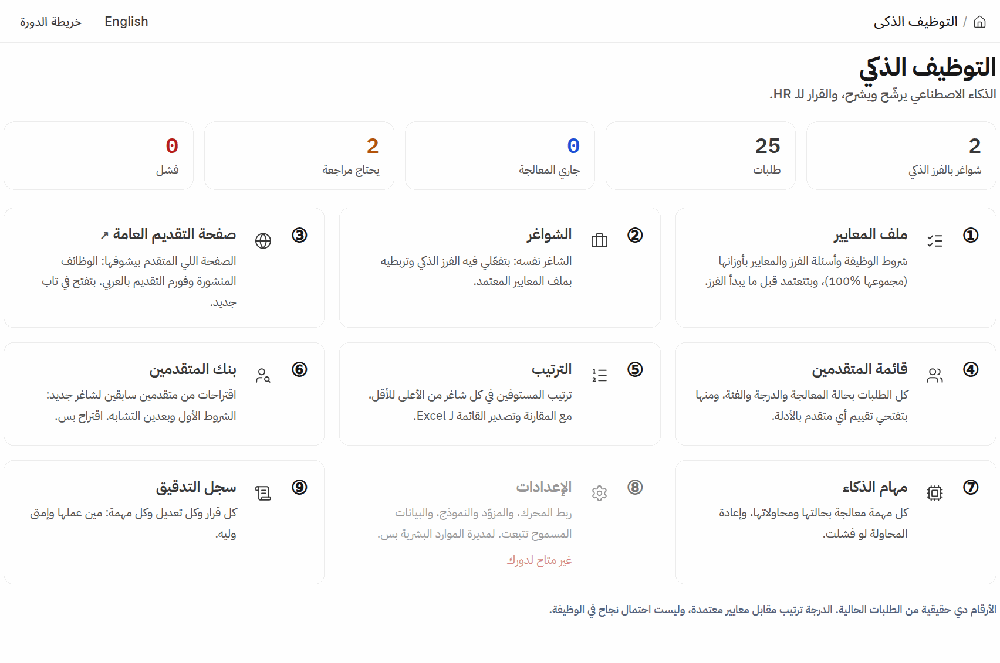

### R09 — An applicant cannot open another applicant's application ✅

| | |
|---|---|
| User | portal.applicant@example.com, Guest |
| Expected | 403 on every call; the desk page refuses |
| Actual | website user {'rest': 403, 'list': 403, 'assessment': 403}, desk: /desk/job-applicant/applicant.2001@example.com denied; guest {'rest': 403, 'assessment': 403} |

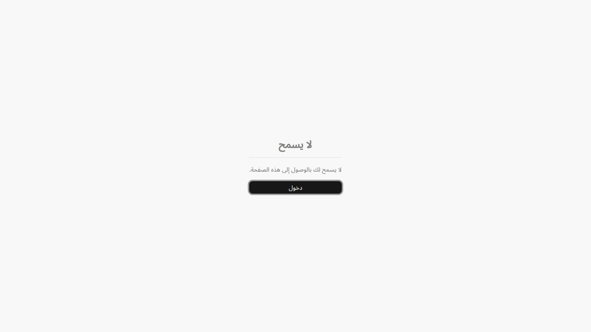

All screenshots: [R09_portal_other_application.png](guide/images/test/R09_portal_other_application.png) · [R09_guest_other_application.png](guide/images/test/R09_guest_other_application.png)

## 4. CV types (public form → HR screen)

### C01 — Arabic scanned image (JPG, OCR) ✅

| | |
|---|---|
| User | Guest → HR Manager |
| File | `HR-APP-2026-2002.jpg` |
| Expected | CV read, redacted, quotes verified |
| Actual | Completed; score 81.5 (high); method ocr:paddle_cpu, OCR confidence 0.91; flags quote_not_found |
| Time | 53.3 s |
| Timing | form 0.86 s · submit 0.28 s · result 53.3 s after submit · engine pipeline 19.4 s |

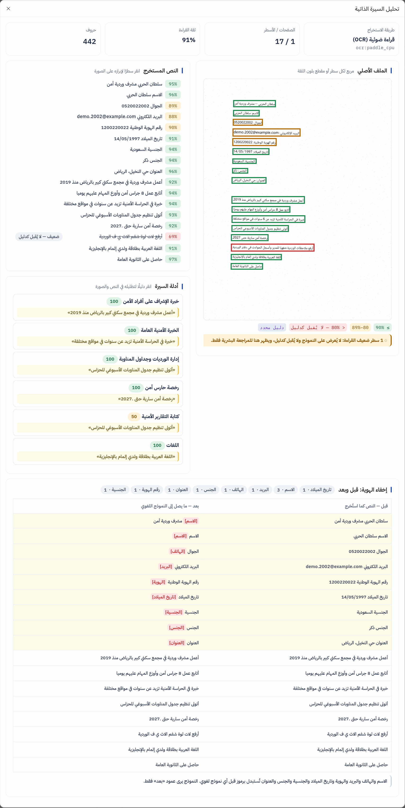

All screenshots: [C01_form.png](guide/images/test/C01_form.png) · [C01_thanks.png](guide/images/test/C01_thanks.png) · [C01_assessment.png](guide/images/test/C01_assessment.png) · [C01_cv_analysis.png](guide/images/test/C01_cv_analysis.png)

### C02 — Arabic text PDF ✅

| | |
|---|---|
| User | Guest → HR Manager |
| File | `HR-APP-2026-2001.pdf` |
| Expected | CV read, redacted, quotes verified |
| Actual | Completed; score 100 (high); method pdf_text |
| Time | 33.0 s |
| Timing | form 0.51 s · submit 0.18 s · result 33.0 s after submit · engine pipeline 22.0 s |

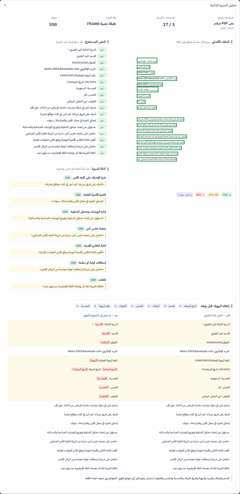

All screenshots: [C02_assessment.png](guide/images/test/C02_assessment.png) · [C02_cv_analysis.png](guide/images/test/C02_cv_analysis.png)

### C03 — English PDF ✅

| | |
|---|---|
| User | Guest → HR Manager |
| File | `HR-APP-2026-2022.pdf` |
| Expected | CV read, redacted, quotes verified |
| Actual | Completed; score 100 (high); method pdf_text |
| Time | 27.1 s |
| Timing | form 0.29 s · submit 0.16 s · result 27.1 s after submit · engine pipeline 16.4 s |

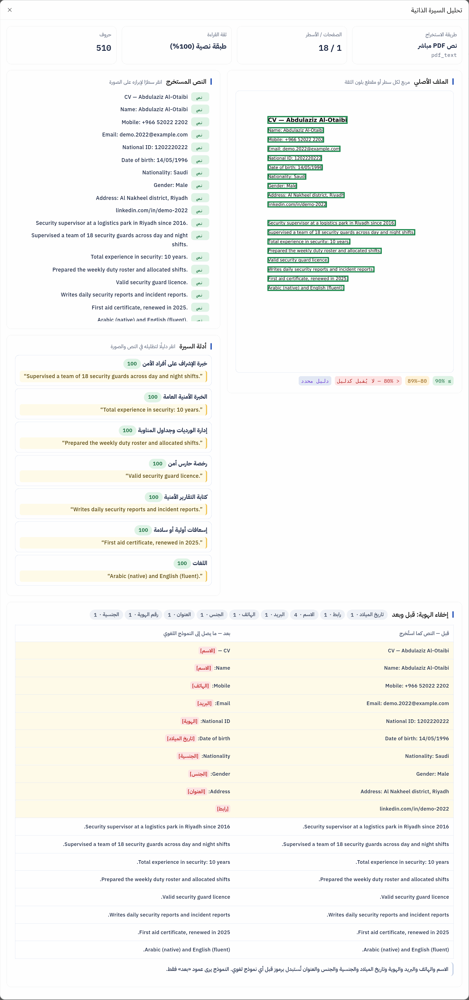

All screenshots: [C03_assessment.png](guide/images/test/C03_assessment.png) · [C03_cv_analysis.png](guide/images/test/C03_cv_analysis.png)

### C04 — Word (DOCX) ✅

| | |
|---|---|
| User | Guest → HR Manager |
| File | `HR-APP-2026-2018.docx` |
| Expected | CV read, redacted, quotes verified |
| Actual | Completed; score 100 (high); method docx |
| Time | 35.2 s |
| Timing | form 0.31 s · submit 0.15 s · result 35.2 s after submit · engine pipeline 19.3 s |

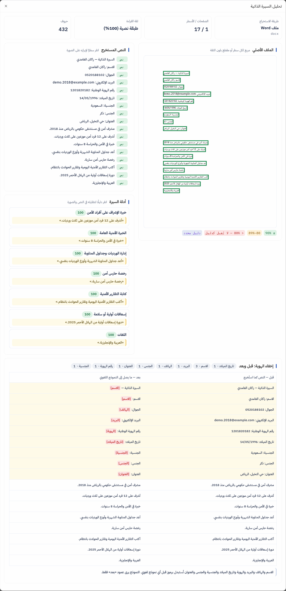

All screenshots: [C04_assessment.png](guide/images/test/C04_assessment.png) · [C04_cv_analysis.png](guide/images/test/C04_cv_analysis.png)

### C05 — RTF (converted from the Word CV) ✅

| | |
|---|---|
| User | Guest → HR Manager |
| File | `HR-APP-2026-2018.rtf` |
| Expected | CV read, redacted, quotes verified |
| Actual | Completed; score 100 (high); method libreoffice+pdf_text |
| History | first run: Failed — «TypeError: Strings must be encoded before hashing» (bug F1); after the fix and a worker restart: Completed |
| Time | 30.5 s |
| Timing | form 0.67 s · submit 0.16 s · result 30.5 s after submit · engine pipeline 19.2 s |

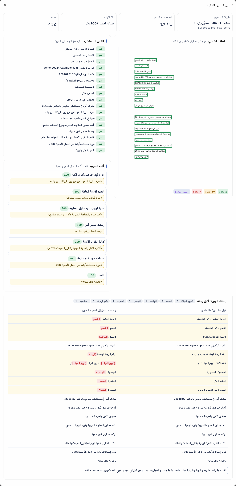

All screenshots: [C05_assessment.png](guide/images/test/C05_assessment.png) · [C05_cv_analysis.png](guide/images/test/C05_cv_analysis.png)

### C06 — DOC, Word 97 (converted from the Word CV) ✅

| | |
|---|---|
| User | Guest → HR Manager |
| File | `HR-APP-2026-2018.doc` |
| Expected | CV read, redacted, quotes verified |
| Actual | Completed; score 100 (high); method libreoffice+pdf_text |
| Time | 31.6 s |
| Timing | form 0.48 s · submit 0.89 s · result 31.6 s after submit · engine pipeline 19.9 s |

All screenshots: [C06_assessment.png](guide/images/test/C06_assessment.png) · [C06_cv_analysis.png](guide/images/test/C06_cv_analysis.png)

### C07 — No CV ✅

| | |
|---|---|
| User | Guest → HR Manager |
| Expected | Completed from the answers; no CV |
| Actual | Completed; score 89 (high); method - |
| Time | 10.0 s |
| Timing | form 0.29 s · submit 0.16 s · result 10.0 s after submit · engine pipeline 1.0 s |

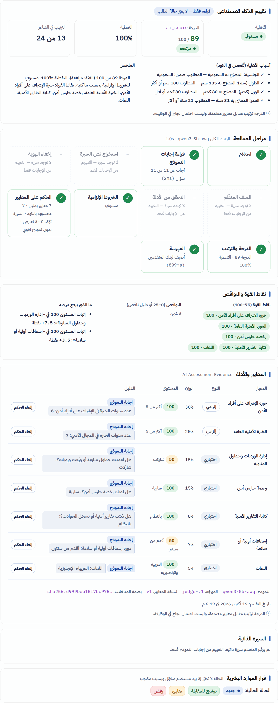

All screenshots: [C07_form.png](guide/images/test/C07_form.png) · [C07_assessment.png](guide/images/test/C07_assessment.png)

### C08 — Corrupt PDF ✅

| | |
|---|---|
| User | Guest → HR Manager |
| File | `HR-APP-2026-2013.pdf` |
| Expected | the platform refuses the file, the application is saved and assessed from the answers (decision 14) |
| Actual | Completed; score 65 (medium); method -; note: ملف السيرة «HR-APP-2026-2013.pdf» تالف أو غير آمن ولم يُحفظ (PdfStreamError). التقييم من الإجابات فقط. |
| Time | 9.9 s |
| Timing | form 0.58 s · submit 0.15 s · result 9.9 s after submit · engine pipeline 1.0 s |

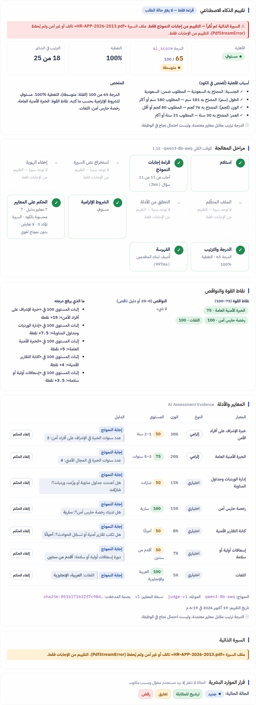

### C09 — Bad-quality image (blurred, noisy, JPEG quality 18) ✅

| | |
|---|---|
| User | Guest → HR Manager |
| File | `HR-APP-2026-2025-bad.jpg` |
| Expected | read with OCR; low confidence flagged if under the threshold |
| Actual | Needs Review; score 93 (high); method ocr:paddle_cpu, OCR confidence 0.79; flags low_ocr_confidence, quote_not_found |
| Time | 45.1 s |
| Timing | form 0.29 s · submit 0.87 s · result 45.1 s after submit · engine pipeline 17.0 s |

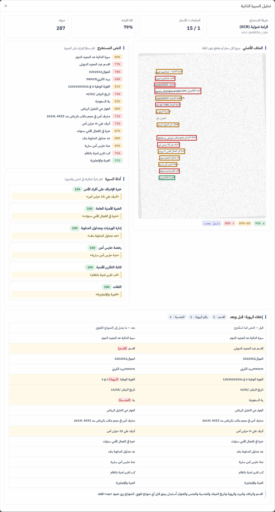

All screenshots: [C09_assessment.png](guide/images/test/C09_assessment.png) · [C09_cv_analysis.png](guide/images/test/C09_cv_analysis.png)

## 5. Special cases

### K01 — Strong, medium and weak applicants ✅

| | |
|---|---|
| User | HR Manager |
| Expected | bands high / medium / low |
| Actual | 2001 (strong): 100 high, rank 1; 2004 (medium): 63 medium, rank 19; 2005 (weak): 48.5 low, rank 22 |

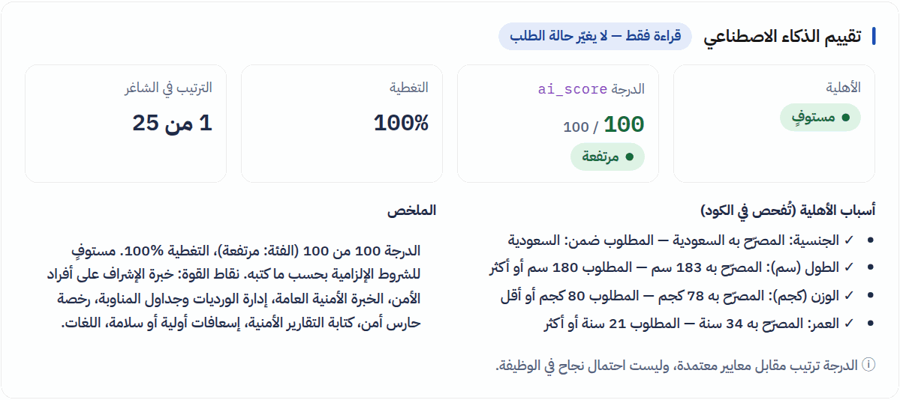

All screenshots: [K01_strong_2001.png](guide/images/test/K01_strong_2001.png) · [K01_medium_2004.png](guide/images/test/K01_medium_2004.png) · [K01_weak_2005.png](guide/images/test/K01_weak_2005.png)

### K02 — Not eligible: height 172 cm and nationality Egypt ✅

| | |
|---|---|
| User | Guest → HR Manager |
| Expected | not eligible with both reasons, kept out of the ranking, score shown in grey |
| Actual | Completed; eligibility not_eligible; failed rules: الجنسية: المصرّح به مصر — المطلوب ضمن: السعودية \| الطول (سم): المصرّح به 172 سم — المطلوب 180 سم أو أكثر; ranked: False |
| Time | 18.9 s |

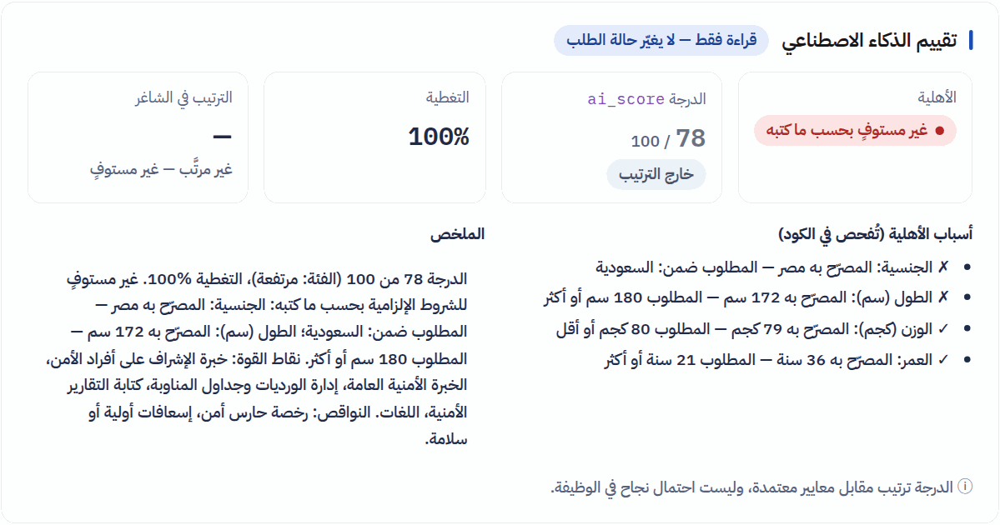

### K03a — Public form: height left blank on an opening with a height rule ✅

| | |
|---|---|
| User | Guest |
| Expected | the form asks for the height before sending (the console case K03b shows the engine side) |
| Actual | message «الطول مطلوب لهذا الشاغر» shown |

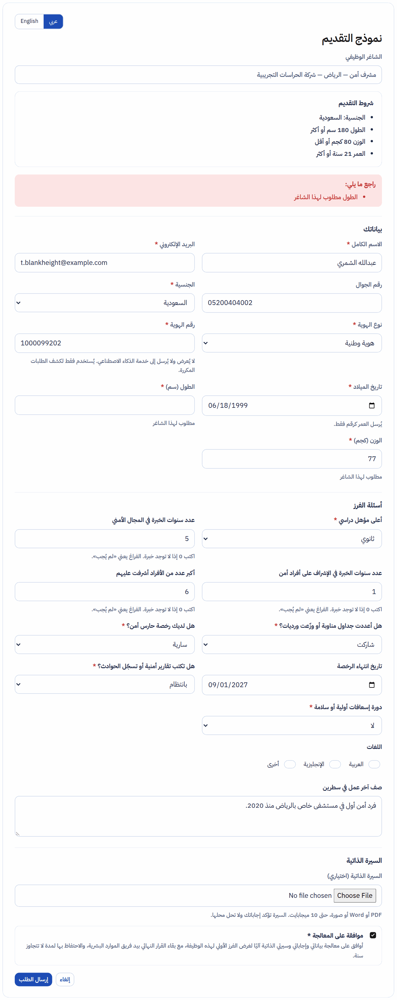

### K03b — Blank height through the console (a host system that allows it) ✅

| | |
|---|---|
| User | Nadine (console) |
| Expected | eligibility «يحتاج مراجعة» with «?» on the height rule, not «غير مستوفٍ» |
| Actual | CON-APP-MVARLAJI: eligibility needs_review; height check الطول (سم): غير مصرّح به (المطلوب 180 سم أو أكثر) — يحتاج مراجعة ok=None |

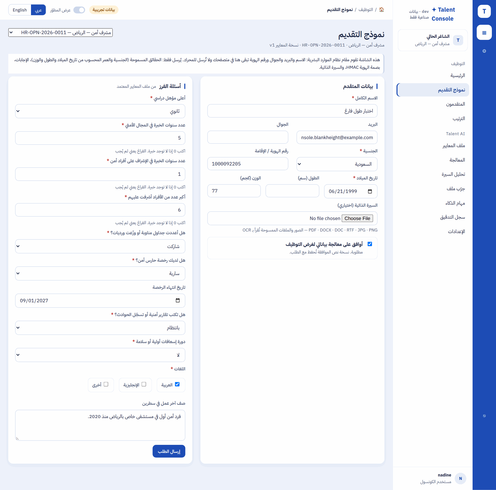

All screenshots: [K03b_console_form.png](guide/images/test/K03b_console_form.png) · [K03b_console_processing.png](guide/images/test/K03b_console_processing.png) · [K03b_console_applicant.png](guide/images/test/K03b_console_applicant.png)

### K04 — Blank answer vs the answer 0 ✅

| | |
|---|---|
| User | HR Manager |
| Expected | blank → level 0 + «دليل ناقص» flag (needs review on a mandatory criterion); 0 → level 0 with the evidence «0», no flag |
| Actual | 2021 (no CV) years_sup='': level 0, missing_evidence True, eligibility eligible; 2006 years_sup='0': level 0, evidence '0', missing_evidence False |
| History | first run failed because the test used applicant 2009, whose CV supplies the supervision evidence (correct behaviour); the test now uses 2021 (blank answer, no CV) |

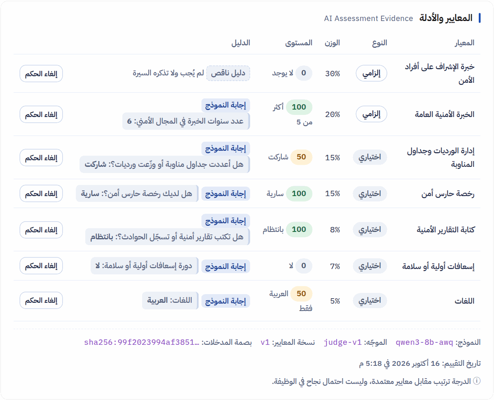

All screenshots: [K04_blank_2021.png](guide/images/test/K04_blank_2021.png) · [K04_zero_2006.png](guide/images/test/K04_zero_2006.png)

### K05 — The answer says one thing, the CV another ✅

| | |
|---|---|
| User | HR Manager |
| Expected | contradiction flag, the lower level is used, needs review before any decision |
| Actual | flags ['contradiction', 'quote_not_found']; supervision: form level 100, CV level 50 → used 50; quote «أشرفت على فريق صغير من الحراس لمدة سنتين» |

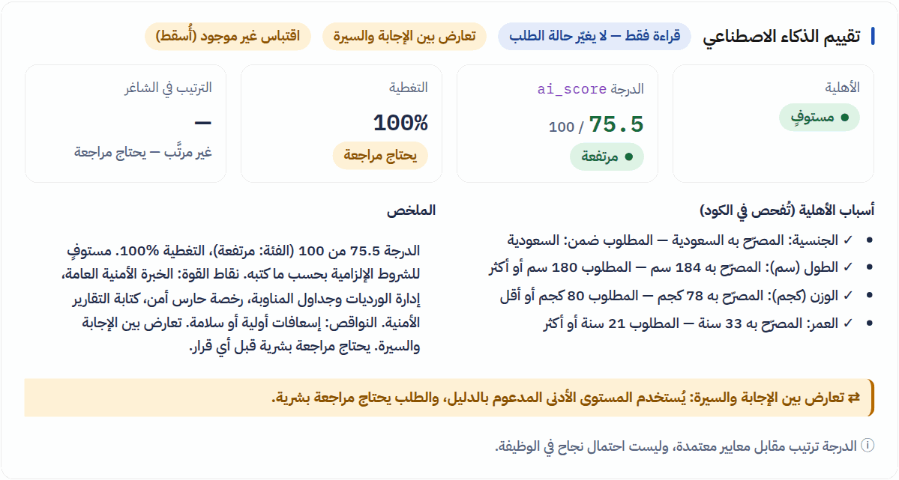

All screenshots: [K05_contradiction_head.png](guide/images/test/K05_contradiction_head.png) · [K05_contradiction_criteria.png](guide/images/test/K05_contradiction_criteria.png)

### K06 — Duplicate applications (same national ID, another e-mail) ✅

| | |
|---|---|
| User | HR Manager |
| Expected | linked to the original, grey, only the original is ranked, nothing deleted |
| Actual | 2016 → applicant.2015@example.com; 2024 → applicant.2003@example.com; in the duplicate group: ['hassan.q.second@example.com', 'khaled.d.second@example.com', 't.enginedown@example.com'] |
| History | first run failed because the test built the duplicate's e-mail from its number; it now reads the e-mails from the demo data |

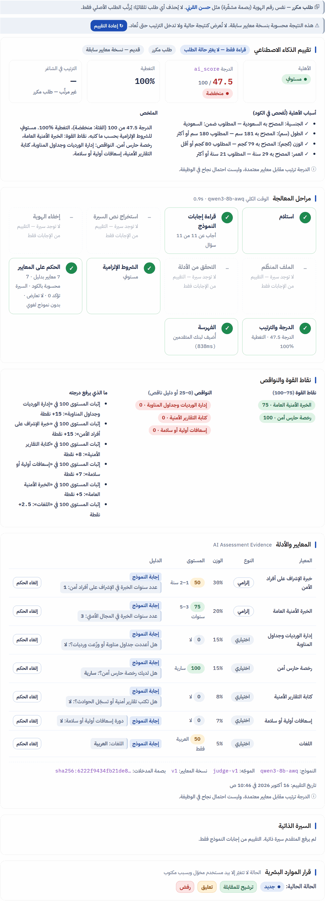

### K07 — Editing an answer after the evaluation ✅

| | |
|---|---|
| User | HR Manager |
| Expected | result marked stale (grey), out of the ranking; re-score → new score, ranked again |
| Actual | stale 1 after 0.0s; in stale group True; score 63 → 78 after re-score (7.4s, Completed); ranked again True |
| Time | 7.4 s |

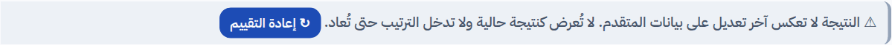

All screenshots: [K07_stale_banner.png](guide/images/test/K07_stale_banner.png) · [K07_rescored.png](guide/images/test/K07_rescored.png)

### K08 — Override one criterion, without and with a reason ✅

| | |
|---|---|
| User | HR Manager |
| Expected | no reason → refused; with a reason → new level, new score, «تعديل HR» tag, audit row |
| Actual | no reason: undefined; supervision → 100; score 81.5 → 89; audit 2 row(s) |
| History | first run failed because the test closed the override dialog together with the «السبب مطلوب» message; it now drives the dialog itself |

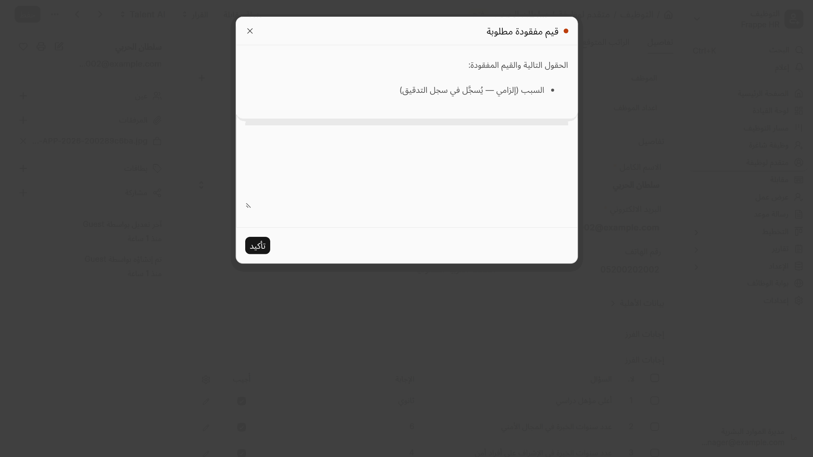

All screenshots: [K08_override_no_reason.png](guide/images/test/K08_override_no_reason.png) · [K08_override_dialog.png](guide/images/test/K08_override_dialog.png) · [K08_override_done.png](guide/images/test/K08_override_done.png)

### K09 — Shortlist, hold and reject, each with a reason; no reason → refused ✅

| | |
|---|---|
| User | HR Manager |
| Expected | status changes only through HR, with the reason, the person and the time in the audit log |
| Actual | 2001: Shortlisted by hr.manager@example.com; 2003: Hold by hr.manager@example.com; 2020: Rejected by hr.manager@example.com; empty reason: refused; audit rows 3 |

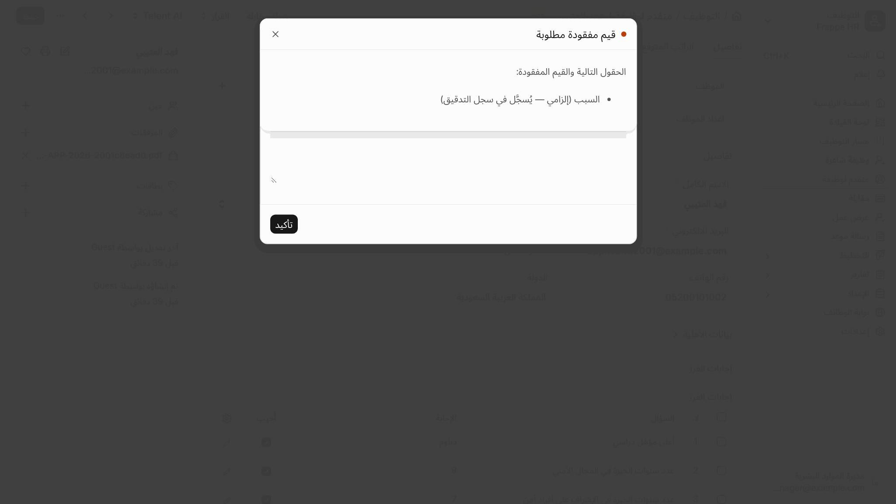

All screenshots: [K09_decision_no_reason.png](guide/images/test/K09_decision_no_reason.png) · [K09_decision_dialog.png](guide/images/test/K09_decision_dialog.png) · [K09_decision_done.png](guide/images/test/K09_decision_done.png)

### K10 — Export the ranking to CSV (Excel) ✅

| | |
|---|---|
| User | HR Manager |
| File | `ranking.csv` |
| Expected | UTF-8 with BOM, Arabic header, one row per applicant, no national ID |
| Actual | 27 rows via same URL fetched by the page; header: الترتيب \| المتقدم \| الاسم \| الدرجة \| الفئة \| التغطية \| حالة المعالجة \| نسخة المعايير; national IDs in the file: 0 |

### K11 — Compare three ranked applicants side by side ✅

| | |
|---|---|
| User | HR Manager |
| Expected | 3 columns, criterion by criterion with evidence |
| Actual | 3 applicant columns |

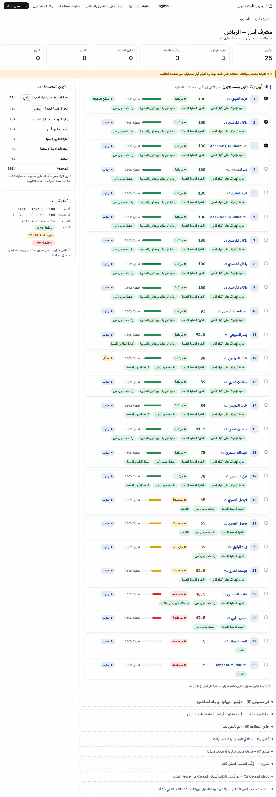

All screenshots: [K11_ranking_selected.png](guide/images/test/K11_ranking_selected.png) · [K11_compare.png](guide/images/test/K11_compare.png)

### K12 — Talent pool for the Jeddah opening ✅

| | |
|---|---|
| User | HR Manager |
| Expected | rules first, then similarity; withdrawn consent and expired retention excluded with the reason |
| Actual | 20 suggested, 9 excluded (consent_withdrawn, duplicate, not_eligible, retention_expired); page 4.8s |
| Time | 4.8 s |

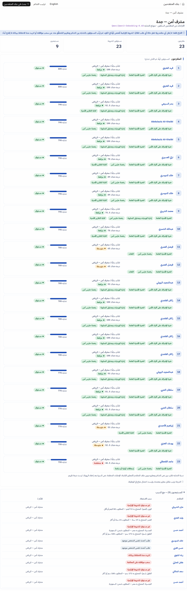

### K13 — An applicant name with HTML/JavaScript is shown as text ✅

| | |
|---|---|
| User | Guest → HR Manager |
| Expected | saved; shown as plain text everywhere; no script runs |
| Actual | submitted True; list: script False, img False; form: script False, img False; ranking: script False, img False |

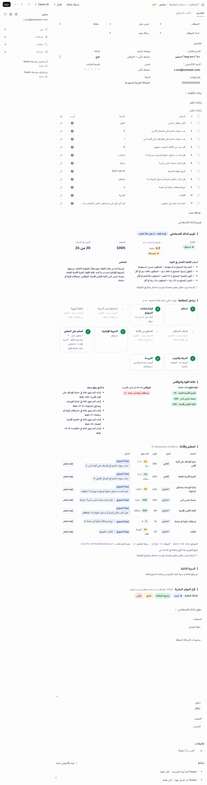

### K14 — Change the weights, approve version 2, re-score everyone ✅

| | |
|---|---|
| User | HR Manager |
| Expected | 105% refused; impact preview; v2 approved; old results stale until re-scored; re-score all |
| Actual | weights before {'supervision': 30, 'security_exp': 20, 'shifts': 20, 'licence': 10, 'reports': 8, 'first_aid': 7, 'languages': 5}; 105% approval refused; v3 with 37 stale; 37 re-scored in 448.8s, 1 skipped (consent withdrawn); stale left 1; top 5 before ['applicant.2001@example.com', 'applicant.2008@example.com', 'applicant.2002@example.com', 'applicant.2003@example.com', 'applicant.2017@example.com'] after ['applicant.2001@example.com', 'applicant.2018@example.com', 'applicant.2022@example.com', 't.cv.arpdf@example.com', 't.cv.enpdf@example.com'] |
| History | first run: 19 of 36 results stayed «قديم» — bug F2; after the fix: all re-scored but the one applicant without consent |
| Time | 448.8 s |

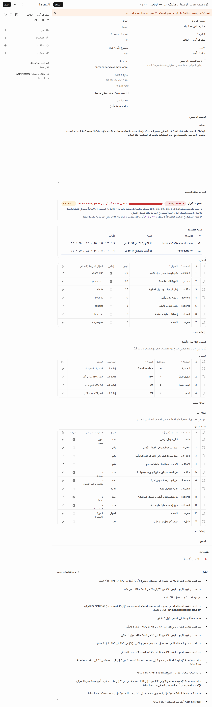

All screenshots: [K14_weights_105.png](guide/images/test/K14_weights_105.png) · [K14_impact_preview.png](guide/images/test/K14_impact_preview.png) · [K14_ranking_stale.png](guide/images/test/K14_ranking_stale.png) · [K14_batch_rescoring.png](guide/images/test/K14_batch_rescoring.png) · [K14_ranking_v2.png](guide/images/test/K14_ranking_v2.png)

### K15 — Engine stopped: apply, then retry ✅

| | |
|---|---|
| User | Guest → HR Manager |
| Expected | the application is saved at once; «فشل» after the retries; «إعادة المحاولة» works when the engine is back |
| Actual | saved in 0.13s while the engine was down; Failed after 25.2s; after retry Completed in 8.7s |
| History | first two runs failed in the test only (a screenshot selector, then an e-mail reused from the first run); the product behaved the same in all three runs |
| Time | 8.7 s |

All screenshots: [K15_saved_engine_down.png](guide/images/test/K15_saved_engine_down.png) · [K15_failed.png](guide/images/test/K15_failed.png) · [K15_after_retry.png](guide/images/test/K15_after_retry.png)

### K16 — Paper application without consent, then HR records the consent ✅

| | |
|---|---|
| User | HR Manager |
| Expected | saved, «بانتظار الموافقة», nothing sent to the AI; empty source refused; consent recorded with its source, who and when; screening starts by itself |
| Actual | status before Awaiting Consent, engine ref none, AI jobs 0, ranking group awaiting_consent: True; empty source refused: True; recorded by hr.manager@example.com at 2026-10-16 15:55:00.509486 (source «ورقة موقّعة»); result Completed 11.1s after the consent; audit rows 1 |
| Time | 11.1 s |

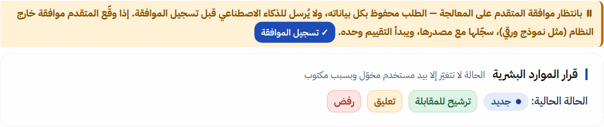

All screenshots: [K16_awaiting.png](guide/images/test/K16_awaiting.png) · [K16_source_required.png](guide/images/test/K16_source_required.png) · [K16_dialog.png](guide/images/test/K16_dialog.png) · [K16_after.png](guide/images/test/K16_after.png)

### K17 — Consent withdrawn: out of the ranking, AI data erased, application kept ✅

| | |
|---|---|
| User | HR Manager |
| Expected | out of the ranking at once into «مستبعد: سحب الموافقة» with no score; engine documents, CV file, profile, index and results erased; Frappe assessment gone; application kept |
| Actual | before: Completed, ranked True, CV file present; after 4.0s: status Consent Withdrawn, score 0, assessments 0, answers kept 11; engine: consent False, facts {}, documents 0, screenings 0, CV file removed, audit findings scrubbed True; ranking group: True, score None; talent pool: consent_withdrawn |
| Time | 4.0 s |

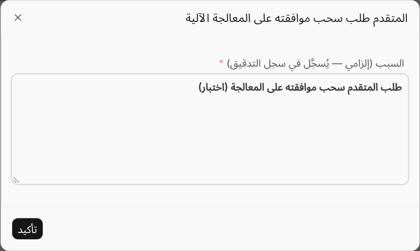

All screenshots: [K17_reason.png](guide/images/test/K17_reason.png) · [K17_after.png](guide/images/test/K17_after.png) · [K17_group.png](guide/images/test/K17_group.png)

## 6. Talent Console (Nadine)

### N01 — Talent Console: login and the main screens ✅

| | |
|---|---|
| User | Nadine (console) |
| Expected | every screen opens |
| Actual | login 1.43s; screens home 2.17s, profile 1.12s, list 1.09s, ranking 1.09s, jobs 1.6s, audit 2.54s, settings 1.83s |
| Time | 1.43 s |

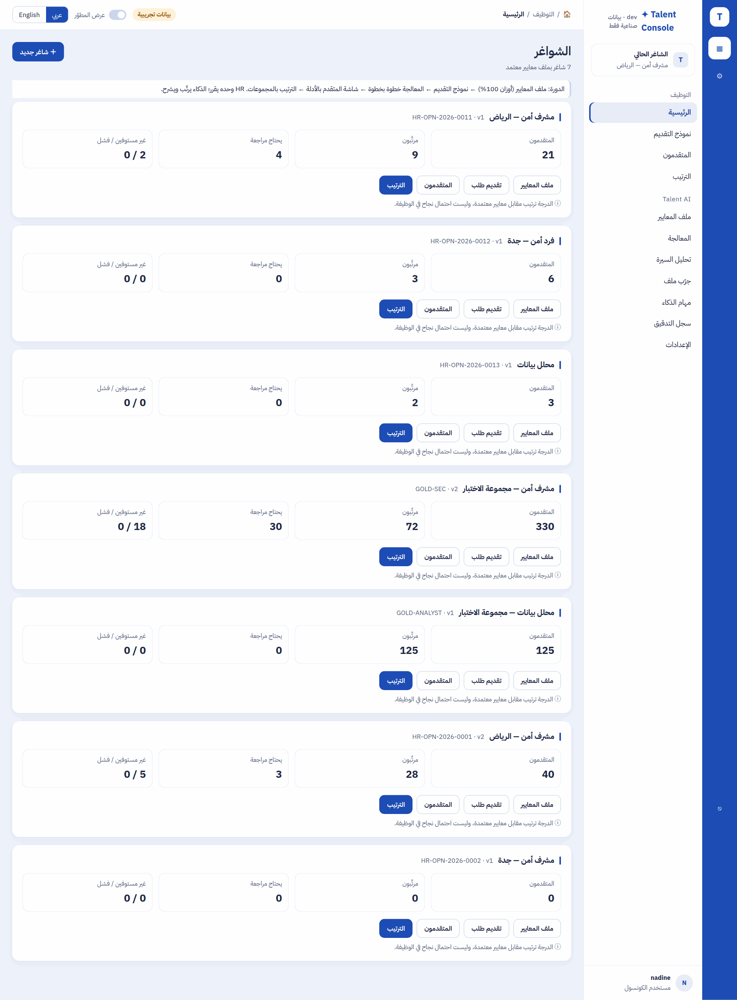

All screenshots: [N01_console_home.png](guide/images/test/N01_console_home.png) · [N01_console_profile.png](guide/images/test/N01_console_profile.png) · [N01_console_list.png](guide/images/test/N01_console_list.png) · [N01_console_ranking.png](guide/images/test/N01_console_ranking.png) · [N01_console_jobs.png](guide/images/test/N01_console_jobs.png) · [N01_console_audit.png](guide/images/test/N01_console_audit.png) · [N01_console_settings.png](guide/images/test/N01_console_settings.png)

### N02 — Try a file: the bad-quality scan ✅

| | |
|---|---|
| User | Nadine (console) |
| File | `HR-APP-2026-2025-bad.jpg` |
| Expected | OCR result with the confidence per line, or «غير مقروء» |
| Actual | status ready, method ocr:paddle_cpu, confidence 0.7893, 23.0s |
| Time | 23.0 s |

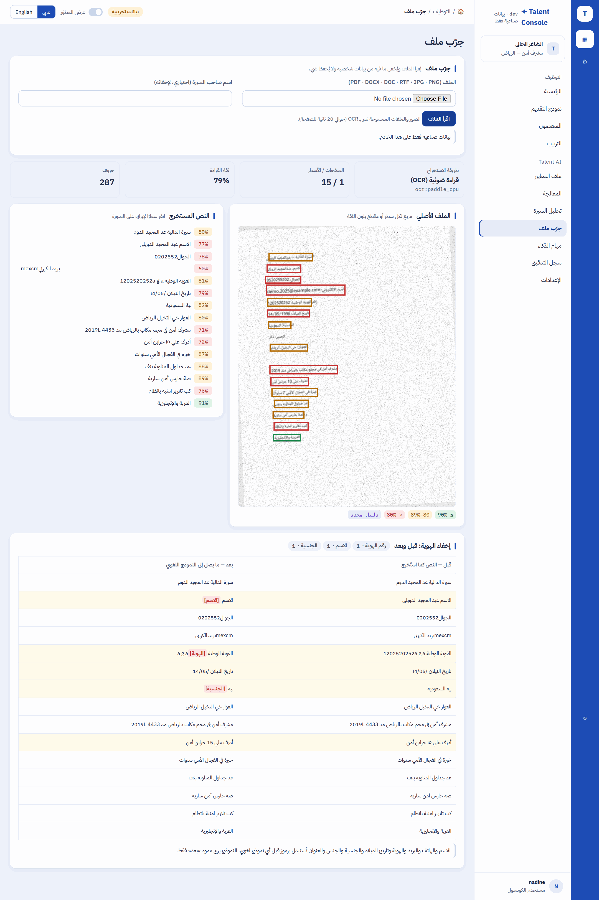

## 7. Page load times

### P01 — Page load times ✅

| | |
|---|---|
| User | HR Manager, Guest |
| Expected | every main page ready in under 5 s (warm) |
| Actual | desk: home: 0.45s; desk: applicant list: 0.96s; desk: applicant with assessment: 0.71s; desk: ranking: 0.46s; desk: talent pool: 2.33s; desk: AI job profile: 0.45s; public: jobs: 0.88s; public: job page: 0.5s; public: application form: 0.28s; public: application form (phone 390 px): 0.72s |

| Page | First load (s) | Warm, median of 2 (s) |
|---|---|---|
| desk: home | 0.58 | 0.45 |
| desk: applicant list | 2.51 | 0.96 |
| desk: applicant with assessment | 1.36 | 0.71 |
| desk: ranking | 0.71 | 0.46 |
| desk: talent pool | 2.81 | 2.33 |
| desk: AI job profile | 0.52 | 0.45 |
| public: jobs | 1.19 | 0.88 |
| public: job page | 0.3 | 0.5 |
| public: application form | 0.78 | 0.28 |
| public: application form (phone 390 px) | 0.72 | — |

### Processing time by CV type

| Test | File | Submit (s) | Result after submit (s) | Engine pipeline (s) |
|---|---|---|---|---|
| C01 Arabic scanned image (JPG, OCR) | `HR-APP-2026-2002.jpg` | 0.28 | 53.3 | 19.4 |
| C02 Arabic text PDF | `HR-APP-2026-2001.pdf` | 0.18 | 33.0 | 22.0 |
| C03 English PDF | `HR-APP-2026-2022.pdf` | 0.16 | 27.1 | 16.4 |
| C04 Word (DOCX) | `HR-APP-2026-2018.docx` | 0.15 | 35.2 | 19.3 |
| C05 RTF (converted from the Word CV) | `HR-APP-2026-2018.rtf` | 0.16 | 30.5 | 19.2 |
| C06 DOC, Word 97 (converted from the Word CV) | `HR-APP-2026-2018.doc` | 0.89 | 31.6 | 19.9 |
| C07 No CV | `—` | 0.16 | 10.0 | 1.0 |
| C08 Corrupt PDF | `HR-APP-2026-2013.pdf` | 0.15 | 9.9 | 1.0 |
| C09 Bad-quality image (blurred, noisy, JPEG quality 18) | `HR-APP-2026-2025-bad.jpg` | 0.87 | 45.1 | 17.0 |

## 8. Design pass (before → after)

Every screen at 1366, 1440 and 1920 px, and the public pages at 375 and 390 px: 110 screens per run, measured in the browser by `tools/ui/design_audit.py` (text boxes that overlap, text cut or off screen, page overflow, text under 11.5 px, contrast under WCAG AA).

| Issue | Before | After |
|---|---|---|
| low-contrast | 6524 | 0 |
| small-font | 2870 | 0 |
| overlap | 825 | 2 |
| off-screen-text | 268 | 0 |
| cut-text | 0 | 0 |
| page-overflow | 0 | 0 |

The two overlaps left are the HRMS «قدّم الآن» button on the phone job page: it stays fixed at the bottom of the screen and the page scrolls under it (standard HRMS behaviour, not changed). No JavaScript error on any of the screens.

Round 3 (2026-10-16): the audit ran again on 99 screens (desk and console at 1366, 1440 and 1920 px, with the three consent screens (paper application awaiting consent, consent recorded, consent withdrawn)): 0 issues, 0 JavaScript errors.

**Desk ranking at 1366 px: strengths on their own line, neutral «إلزامي», bands as chips**

| Before | After |
|---|---|
| 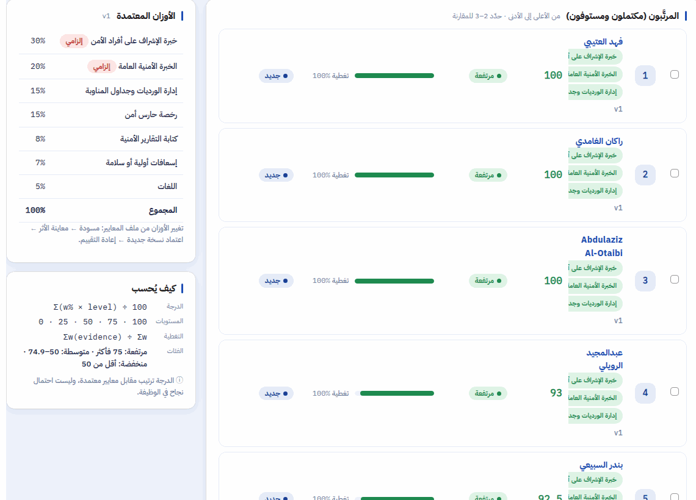 | 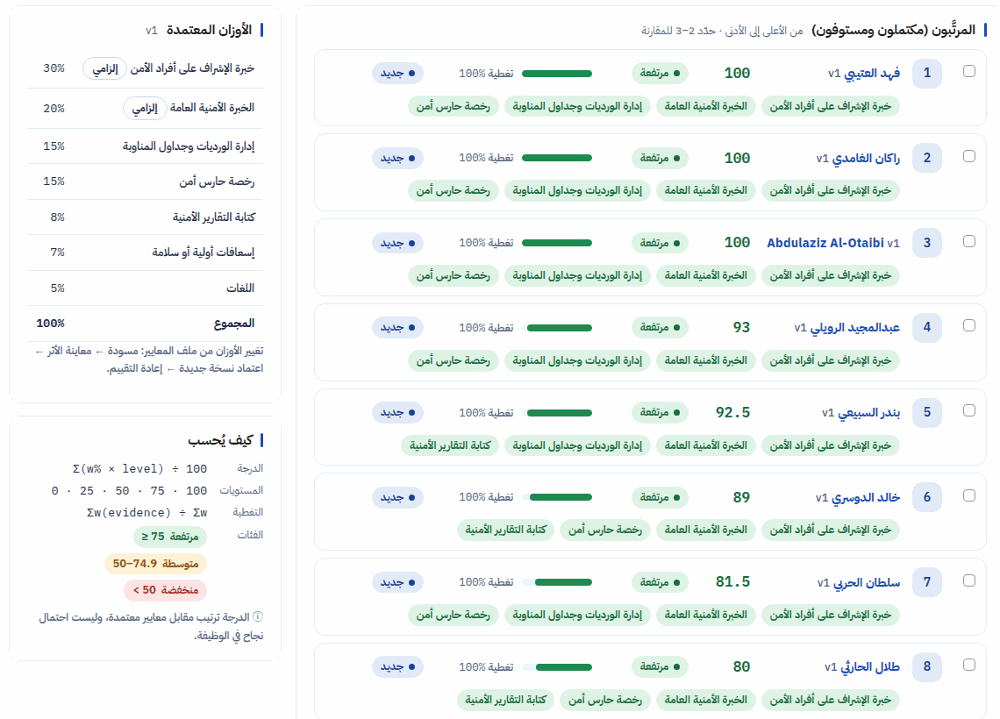 |

**The 10 processing stages at 1440 px: Arabic notes in order, 4 columns inside the AI section**

| Before | After |
|---|---|
| 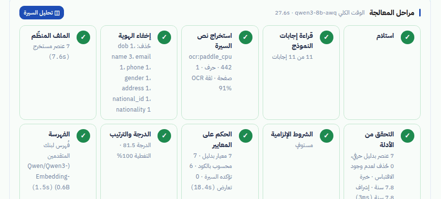 | 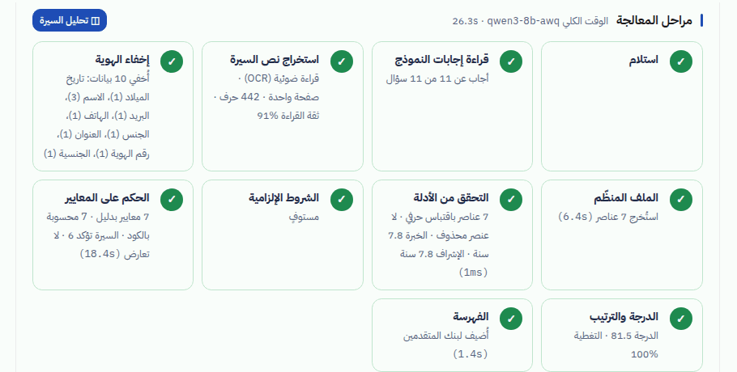 |

**Applicant form at 1440 px: HRMS labels in Arabic (Schedule Interview, Applicant Rating, Salary Expectation, Last Edited By)**

| Before | After |
|---|---|
| 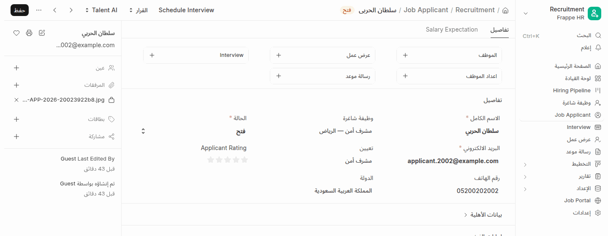 | 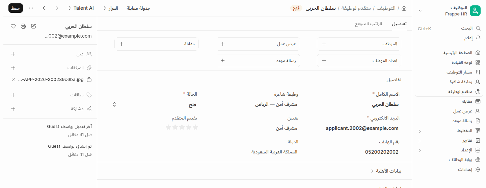 |

**Console ranking at 1366 px: the reference is no longer cut and no longer runs under the score**

| Before | After |
|---|---|
| 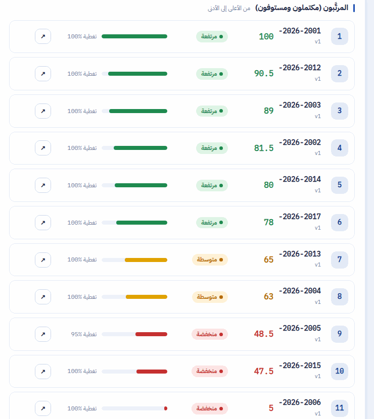 | 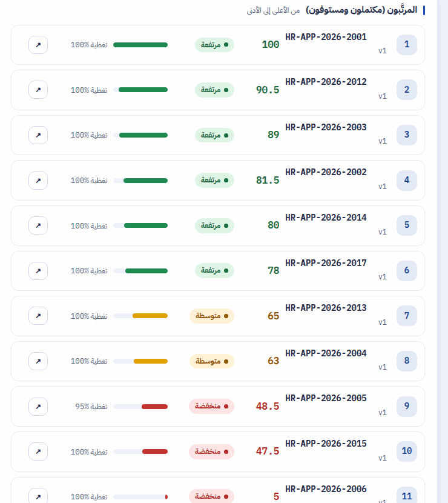 |

**Console criteria editor at 1366 px: delete buttons visible, «إلزامي» on one line, Arabic hints in the Arabic font**

| Before | After |
|---|---|
| 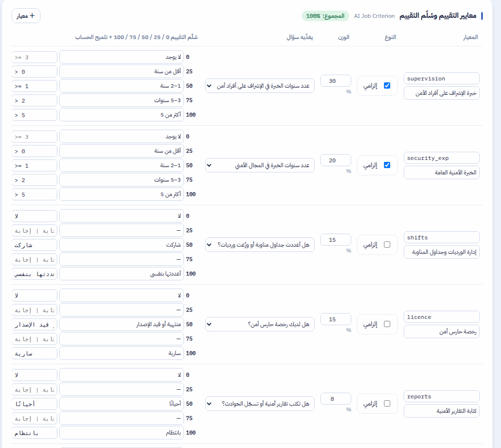 | 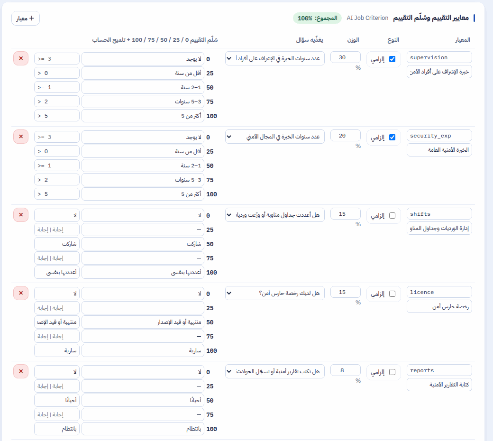 |

## 10. Automated tests

Engine: `make test` in `talent-engine/` — 120 passed, 1 skipped (the PaddleOCR test runs only with RUN_OCR_TESTS=1). Frappe app: `bench --site test.localhost run-tests --app ido_talent_ai` — 22 passed.

| Suite | File | Test | What it checks |
|---|---|---|---|
| engine | `talent-engine/tests/test_answers_and_fake.py` | `test_blank_is_not_answered_and_zero_is_an_answer` |  |
| engine | `talent-engine/tests/test_answers_and_fake.py` | `test_years_rubric_thresholds_match_demo` |  |
| engine | `talent-engine/tests/test_answers_and_fake.py` | `test_language_rubric` |  |
| engine | `talent-engine/tests/test_answers_and_fake.py` | `test_fake_judge_is_deterministic_and_cites_the_stored_answer` |  |
| engine | `talent-engine/tests/test_answers_and_fake.py` | `test_missing_answer_is_missing_evidence_never_a_guess` |  |
| engine | `talent-engine/tests/test_answers_and_fake.py` | `test_evidence_mismatch_is_dropped` |  |
| engine | `talent-engine/tests/test_api.py` | `test_auth_required` |  |
| engine | `talent-engine/tests/test_api.py` | `test_weights_must_total_100` |  |
| engine | `talent-engine/tests/test_api.py` | `test_same_content_does_not_create_new_version` |  |
| engine | `talent-engine/tests/test_api.py` | `test_unknown_fact_rejected` |  |
| engine | `talent-engine/tests/test_api.py` | `test_full_cycle_matches_the_demo` |  |
| engine | `talent-engine/tests/test_api.py` | `test_worked_example_details` |  |
| engine | `talent-engine/tests/test_api.py` | `test_blank_vs_zero_and_needs_review` |  |
| engine | `talent-engine/tests/test_api.py` | `test_not_eligible_is_kept_not_rejected` |  |
| engine | `talent-engine/tests/test_api.py` | `test_duplicate_linked_nothing_deleted` |  |
| engine | `talent-engine/tests/test_api.py` | `test_override_requires_reason_and_recomputes` |  |
| engine | `talent-engine/tests/test_api.py` | `test_edit_after_evaluation_marks_stale_until_rescreen` |  |
| engine | `talent-engine/tests/test_api.py` | `test_new_profile_version_makes_results_stale_and_rescreen_updates` |  |
| engine | `talent-engine/tests/test_api.py` | `test_idempotent_screening_by_input_hash` |  |
| engine | `talent-engine/tests/test_api.py` | `test_delete_candidate_removes_everything` |  |
| engine | `talent-engine/tests/test_api.py` | `test_two_jobs_do_not_mix` |  |
| engine | `talent-engine/tests/test_api.py` | `test_settings_engine_owned` |  |
| engine | `talent-engine/tests/test_api.py` | `test_draft_criteria_sums_to_100` |  |
| engine | `talent-engine/tests/test_api.py` | `test_callback_is_signed_and_delivered` |  |
| engine | `talent-engine/tests/test_api.py` | `test_engine_failure_becomes_failed_after_retries_then_retry_works` |  |
| engine | `talent-engine/tests/test_api.py` | `test_unknown_rule_operator_rejected_by_api` |  |
| engine | `talent-engine/tests/test_api.py` | `test_api_key_rotation_on_restart` |  |
| engine | `talent-engine/tests/test_api.py` | `test_impact_preview_keeps_levels_and_moves_weights` |  |
| engine | `talent-engine/tests/test_api.py` | `test_delete_job_removes_versions_and_screenings_but_keeps_candidates` |  |
| engine | `talent-engine/tests/test_api.py` | `test_applied_at_orders_duplicates_and_starts_retention` |  |
| engine | `talent-engine/tests/test_api.py` | `test_copy_screened_before_its_original_is_marked_duplicate_afterwards` |  |
| engine | `talent-engine/tests/test_api.py` | `test_talent_pool_rules_first_then_similarity_with_exclusions` | Feature 13 on the demo candidates (fake embeddings): a new opening of the same kind. |
| engine | `talent-engine/tests/test_config.py` | `test_every_env_key_is_used` |  |
| engine | `talent-engine/tests/test_config.py` | `test_settings_load_with_defaults_only` |  |
| engine | `talent-engine/tests/test_consent.py` | `test_withdrawn_consent_erases_the_ai_data_and_leaves_the_ranking` |  |
| engine | `talent-engine/tests/test_consent.py` | `test_withdrawing_the_original_promotes_the_later_copy` |  |
| engine | `talent-engine/tests/test_consent.py` | `test_a_file_shared_by_two_candidates_stays_until_the_last_one_goes` |  |
| engine | `talent-engine/tests/test_consent.py` | `test_deleting_a_candidate_also_removes_the_cv_file` |  |
| engine | `talent-engine/tests/test_consent.py` | `test_a_run_that_meets_a_withdrawal_keeps_nothing` | The worker locks the candidate before it writes; a withdrawal that came first wins. |
| engine | `talent-engine/tests/test_consent.py` | `test_consent_given_again_starts_afresh` |  |
| engine | `talent-engine/tests/test_consent.py` | `test_a_candidate_sent_without_consent_is_kept_bare` |  |
| engine | `talent-engine/tests/test_consent.py` | `test_withdrawal_is_idempotent` |  |
| engine | `talent-engine/tests/test_console.py` | `test_console_requires_login_and_hides_the_api_key` |  |
| engine | `talent-engine/tests/test_console.py` | `test_console_actions_are_audited_with_the_user` |  |
| engine | `talent-engine/tests/test_console.py` | `test_id_token_helper_matches_hmac_and_needs_login` |  |
| engine | `talent-engine/tests/test_console.py` | `test_session_token_expiry_and_tamper` |  |
| engine | `talent-engine/tests/test_console.py` | `test_login_disabled_without_password` |  |
| engine | `talent-engine/tests/test_console.py` | `test_static_path_traversal_blocked` |  |
| engine | `talent-engine/tests/test_console.py` | `test_fonts_are_served_locally` | The console never calls a third-party font service; the fonts ship with the app. |
| engine | `talent-engine/tests/test_cv_api.py` | `test_upload_replaces_stale_and_shows_in_screening` |  |
| engine | `talent-engine/tests/test_cv_api.py` | `test_corrupt_cv_never_fails_the_screening` |  |
| engine | `talent-engine/tests/test_cv_api.py` | `test_low_ocr_confidence_needs_review` |  |
| engine | `talent-engine/tests/test_cv_api.py` | `test_inspect_stores_nothing` |  |
| engine | `talent-engine/tests/test_cv_api.py` | `test_upload_size_limit` |  |
| engine | `talent-engine/tests/test_cv_api.py` | `test_settings_show_ocr_readiness` |  |
| engine | `talent-engine/tests/test_cv_api.py` | `test_reprocessed_cv_is_new_input` |  |
| engine | `talent-engine/tests/test_documents.py` | `test_sniff_by_magic_bytes` |  |
| engine | `talent-engine/tests/test_documents.py` | `test_text_pdf` |  |
| engine | `talent-engine/tests/test_documents.py` | `test_scanned_pdf_needs_ocr` |  |
| engine | `talent-engine/tests/test_documents.py` | `test_image_cv` |  |
| engine | `talent-engine/tests/test_documents.py` | `test_docx` |  |
| engine | `talent-engine/tests/test_documents.py` | `test_corrupt_and_encrypted` |  |
| engine | `talent-engine/tests/test_documents.py` | `test_rtf_through_libreoffice` |  |
| engine | `talent-engine/tests/test_documents.py` | `test_ocr_without_text_is_unreadable` |  |
| engine | `talent-engine/tests/test_documents.py` | `test_row_reconstruction_bidi` |  |
| engine | `talent-engine/tests/test_documents.py` | `test_generated_arabic_pdf_if_present` |  |
| engine | `talent-engine/tests/test_layout.py` | `test_text_pdf_layout_lines_match_text` |  |
| engine | `talent-engine/tests/test_layout.py` | `test_ocr_layout_scaled_to_display_pixels` |  |
| engine | `talent-engine/tests/test_layout.py` | `test_image_layout_native_pixels` |  |
| engine | `talent-engine/tests/test_layout.py` | `test_docx_gets_a_pdf_preview_with_layout` |  |
| engine | `talent-engine/tests/test_layout.py` | `test_quote_maps_to_line_and_ocr_segments` |  |
| engine | `talent-engine/tests/test_layout.py` | `test_redaction_keeps_line_count_for_before_after_view` |  |
| engine | `talent-engine/tests/test_layout.py` | `test_api_cv_layout_pages_file_and_quote_boxes` |  |
| engine | `talent-engine/tests/test_llm.py` | `test_local_provider_full_cycle` |  |
| engine | `talent-engine/tests/test_llm.py` | `test_contradiction_uses_lower_level_and_needs_review` |  |
| engine | `talent-engine/tests/test_llm.py` | `test_invented_quote_is_dropped_never_guessed` |  |
| engine | `talent-engine/tests/test_llm.py` | `test_structured_answers_are_judged_in_code_not_by_the_model` |  |
| engine | `talent-engine/tests/test_llm.py` | `test_invalid_json_repaired_once_then_fails` |  |
| engine | `talent-engine/tests/test_llm.py` | `test_cloud_switch_is_only_a_setting` |  |
| engine | `talent-engine/tests/test_llm.py` | `test_quote_matching_and_years_in_code` |  |
| engine | `talent-engine/tests/test_llm.py` | `test_strict_schema_requires_every_property` |  |
| engine | `talent-engine/tests/test_llm.py` | `test_form_value_tolerance_and_question_from_job` |  |
| engine | `talent-engine/tests/test_llm.py` | `test_llm_draft_is_normalised_into_an_approvable_job` |  |
| engine | `talent-engine/tests/test_llm.py` | `test_cv_duration_is_levelled_in_code_not_by_the_model` | Demo 2012: the model gave «لمدة سنتين» level 100; code reads 2 years -> 50 -> contradiction. |
| engine | `talent-engine/tests/test_ocr_paddle.py` | `test_paddle_cpu_reads_arabic_scan` |  |
| engine | `talent-engine/tests/test_redaction.py` | `test_arabic_cv_is_fully_redacted` |  |
| engine | `talent-engine/tests/test_redaction.py` | `test_idempotent_and_digits_normalised` |  |
| engine | `talent-engine/tests/test_redaction.py` | `test_name_variants_and_prefix` |  |
| engine | `talent-engine/tests/test_redaction.py` | `test_english_cv_regex_only` |  |
| engine | `talent-engine/tests/test_redaction.py` | `test_phone_formats` |  |
| engine | `talent-engine/tests/test_redaction.py` | `test_age_and_gender_keywords_only` |  |
| engine | `talent-engine/tests/test_redaction.py` | `test_presidio_english_person_if_installed` |  |
| engine | `talent-engine/tests/test_redaction.py` | `test_ocr_style_alef_variants_in_keywords` |  |
| engine | `talent-engine/tests/test_redaction.py` | `test_id_keyword_keeps_newline` |  |
| engine | `talent-engine/tests/test_redaction.py` | `test_presidio_leaves_arabic_lines_alone` |  |
| engine | `talent-engine/tests/test_redaction.py` | `test_dates_with_spaces_and_year_first` |  |
| engine | `talent-engine/tests/test_redaction.py` | `test_split_dob_line_is_fully_scrubbed` |  |
| engine | `talent-engine/tests/test_rules.py` | `test_eligible` |  |
| engine | `talent-engine/tests/test_rules.py` | `test_not_eligible_as_declared_height` |  |
| engine | `talent-engine/tests/test_rules.py` | `test_not_eligible_nationality_beats_missing` |  |
| engine | `talent-engine/tests/test_rules.py` | `test_missing_value_needs_review` |  |
| engine | `talent-engine/tests/test_rules.py` | `test_arabic_normalisation_and_digits` |  |
| engine | `talent-engine/tests/test_rules.py` | `test_requirement_sentences` |  |
| engine | `talent-engine/tests/test_rules.py` | `test_no_rules_is_eligible` |  |
| engine | `talent-engine/tests/test_rules.py` | `test_unknown_operator_is_rejected` |  |
| engine | `talent-engine/tests/test_rules.py` | `test_every_operator` |  |
| engine | `talent-engine/tests/test_rules.py` | `test_between_needs_a_pair` |  |
| engine | `talent-engine/tests/test_rules.py` | `test_non_numeric_value_for_numeric_operator_fails_the_rule_not_the_engine` |  |
| engine | `talent-engine/tests/test_scoring.py` | `test_worked_example_security_supervisor_81_5` |  |
| engine | `talent-engine/tests/test_scoring.py` | `test_client_doc_example_89` |  |
| engine | `talent-engine/tests/test_scoring.py` | `test_bands_at_boundaries` |  |
| engine | `talent-engine/tests/test_scoring.py` | `test_rounding_half_up` |  |
| engine | `talent-engine/tests/test_scoring.py` | `test_mandatory_zero_with_evidence_forces_low_band` |  |
| engine | `talent-engine/tests/test_scoring.py` | `test_mandatory_missing_evidence_needs_review_not_low_band` |  |
| engine | `talent-engine/tests/test_scoring.py` | `test_coverage_threshold_60` |  |
| engine | `talent-engine/tests/test_scoring.py` | `test_contradiction_needs_review` |  |
| engine | `talent-engine/tests/test_scoring.py` | `test_override_recomputes_and_counts_as_evidence` |  |
| engine | `talent-engine/tests/test_scoring.py` | `test_strengths_and_gaps` |  |
| engine | `talent-engine/tests/test_security.py` | `test_hmac_sign_and_verify` |  |
| engine | `talent-engine/tests/test_security.py` | `test_old_timestamp_rejected` |  |
| engine | `talent-engine/tests/test_security.py` | `test_api_key_hash_is_stable` |  |
| Frappe | `ido_talent_ai/ido_talent_ai/tests/test_talent_ai.py` | `test_application_saved_with_all_answers_even_if_engine_down` |  |
| Frappe | `ido_talent_ai/ido_talent_ai/tests/test_talent_ai.py` | `test_missing_required_answer_and_consent_are_refused` |  |
| Frappe | `ido_talent_ai/ido_talent_ai/tests/test_talent_ai.py` | `test_blank_is_never_zero` |  |
| Frappe | `ido_talent_ai/ido_talent_ai/tests/test_talent_ai.py` | `test_engine_payload_has_no_identity` |  |
| Frappe | `ido_talent_ai/ido_talent_ai/tests/test_talent_ai.py` | `test_result_sets_ai_fields_but_never_the_status` |  |
| Frappe | `ido_talent_ai/ido_talent_ai/tests/test_talent_ai.py` | `test_hr_decision_needs_a_reason_and_is_logged` |  |
| Frappe | `ido_talent_ai/ido_talent_ai/tests/test_talent_ai.py` | `test_ai_fields_are_hr_only` |  |
| Frappe | `ido_talent_ai/ido_talent_ai/tests/test_talent_ai.py` | `test_edit_after_evaluation_makes_the_result_stale` |  |
| Frappe | `ido_talent_ai/ido_talent_ai/tests/test_talent_ai.py` | `test_callback_signature` |  |
| Frappe | `ido_talent_ai/ido_talent_ai/tests/test_talent_ai.py` | `test_weights_must_total_100_to_approve` |  |
| Frappe | `ido_talent_ai/ido_talent_ai/tests/test_talent_ai.py` | `test_ai_section_is_on_the_main_tab_of_the_opening` | The guide screenshots found the Talent AI section of Job Opening inside the «Pay Details» tab. |
| Frappe | `ido_talent_ai/ido_talent_ai/tests/test_talent_ai.py` | `test_opening_points_the_apply_button_to_the_ai_form` |  |
| Frappe | `ido_talent_ai/ido_talent_ai/tests/test_talent_ai.py` | `test_talent_pool_names_suggestions_and_exclusions` |  |
| Frappe | `ido_talent_ai/ido_talent_ai/tests/test_talent_ai.py` | `test_withdrawn_consent_stops_processing` |  |
| Frappe | `ido_talent_ai/ido_talent_ai/tests/test_talent_ai.py` | `test_paper_application_waits_until_hr_records_the_consent` | #20: saved as usual, never screened without consent; HR records the consent with a |
| Frappe | `ido_talent_ai/ido_talent_ai/tests/test_talent_ai.py` | `test_withdrawn_consent_leaves_the_ranking_and_erases_the_ai_data` | #21: out of the ranking at once, in «مستبعد: سحب الموافقة» with no score and no details; |
| Frappe | `ido_talent_ai/ido_talent_ai/tests/test_talent_ai.py` | `test_withdrawal_while_the_engine_is_down_is_erased_later` |  |
| Frappe | `ido_talent_ai/ido_talent_ai/tests/test_talent_ai.py` | `test_the_safety_nets_read_the_site_clock` | `creation` and `finished_on` are in the site's time zone while the database clock may be |
| Frappe | `ido_talent_ai/ido_talent_ai/tests/test_talent_ai.py` | `test_application_is_always_saved` | Acceptance criterion 6 as a permanent test: nothing on the AI side can lose an application. |
| Frappe | `ido_talent_ai/ido_talent_ai/tests/test_talent_ai.py` | `test_text_cv_is_sent_as_bytes_and_cv_problems_never_fail` | RTF is a text format, so Frappe's File.get_content() returns str for it (the full browser test |
| Frappe | `ido_talent_ai/ido_talent_ai/tests/test_talent_ai.py` | `test_every_hr_method_refuses_other_users_first` | Every whitelisted method except the public form, the job requirements, the signed engine |
| Frappe | `ido_talent_ai/ido_talent_ai/tests/test_talent_ai.py` | `test_hr_users_land_on_the_home_page_in_arabic` |  |

## 11. Commands

Every make target and script of the inventory, with what was run in round 2. Targets that would stop or change the shared stack (`down`, `up`, `revision`, `seed`, `cvs`, `receiver`, `logs`) were checked with `make -n` only; `build` and the compose restarts were run for real (default builder).

| Command | Mode | Result |
|---|---|---|
| `make builder-check` | run | ok |
| `make install` | run | ok |
| `make test` | run | ok |
| `make lint` | run | ok |
| `make fmt` | run | ok |
| `make typecheck` | run | ok |
| `make gpu` | run | ok |
| `make ps` | run | ok |
| `make migrate` | run | ok |
| `make -n build` | dry run | dry run ok; built for real this round (default builder) |
| `make -n env` | dry run | dry run ok |
| `make -n up` | dry run | dry run ok |
| `make -n down` | dry run | dry run ok |
| `make -n logs` | dry run | dry run ok |
| `make -n llm-logs` | dry run | dry run ok |
| `make -n revision` | dry run | dry run ok |
| `make -n seed` | dry run | dry run ok |
| `make -n cvs` | dry run | dry run ok |
| `make -n receiver` | dry run | dry run ok |
| `talent-engine/scripts/compose.sh` | run | run in round 2: restart of api and workers |
| `dev-frappe/reset_demo.sh` | run | run in round 2: demo rebuilt (25 applicants) |
| `dev-frappe/init_env.sh` | run | run in round 2: extra test-user passwords added |
| `dev-frappe/start.sh` | run | run in round 2: bench restarted twice |
| `dev-frappe/setup.sh` | run | run in round 2: run inside reset_demo (site setup) |
| `tools/ui/full_test.py` | run | run in round 2: full browser test |
| `tools/ui/design_audit.py` | run | run in round 2: 3 design audits |
| `tools/ui/design_pairs.py` | run | run in round 2: before/after pairs |
| `tools/ui/pw.py` | run | run in round 2: used by every browser tool |
| `tools/ui/test_report.py` | run | run in round 2: docs/TEST_REPORT.md |
| `tools/ui/apply_via_form.py` | run | run in round 2: applicant 2017 through the real form |
| `ido_talent_ai/ido_talent_ai/scripts/seed_demo.py` | run | run in round 2: demo setup and test users |
| `ido_talent_ai/ido_talent_ai/scripts/submit_demo_applications.py` | run | run in round 2: 24 applications |
| `tools/guide/facts.py` | run | run in round 2: guide numbers |
| `tools/guide/shots.py` | run | run in round 2: guide screenshots |
| `tools/guide/build.py` | run | run in round 2: guide build |
| `tools/guide/inventory.py` | run | run in round 2: inventory |
| `tools/guide/lint_ar.py` | run | run in round 2: writing rules |
| `tools/guide/inv.py` | run | run in round 2: item codes |
| `tools/guide/model.py` | run | run in round 2: guide content model |
| `tools/guide/render_html.py` | run | run in round 2: PDF |
| `tools/guide/render_docx.py` | run | run in round 2: Word |
| `tools/guide/docshots.py` | run | run in round 2: this file |
| `tools/guide/coverage_check.py` | run | run in round 2: coverage check |
| `tools/ui/acceptance.py` | earlier | run in phase 7 (docs/ACCEPTANCE_REPORT.md) |
| `tools/ui/walkthrough_shots.py` | earlier | run in phase 8 (docs/WALKTHROUGH.md) |
| `tools/ui/desk_shots.py` | earlier | run in phase 6 |
| `tools/ui/frappe_ui.py` | earlier | run in phases 6–8 (CDP driver of the older tools) |
| `talent-engine/scripts/callback_receiver.py` | earlier | run in phase 1 (HMAC callback verified) |
| `talent-engine/scripts/make_cvs.py` | earlier | run in phase 2 (`make cvs`) |
| `talent-engine/scripts/cv_texts.py` | earlier | run in phase 2 |
| `talent-engine/scripts/seed.py` | earlier | run in phase 1 (`make seed`) |
| `talent-engine/scripts/seed_data.py` | earlier | run in phase 1 |
| `talent-engine/scripts/init_env.py` | earlier | run in phase 1 (`make env`) |
| `talent-engine/eval/run.py` | earlier | run in phase 4 (docs/EVALUATION_REPORT.md) |
| `talent-engine/eval/bench.py` | earlier | run in phase 4 |
| `talent-engine/eval/make_gold.py` | earlier | run in phase 4 |
| `dev-frappe/clean_install.sh` | earlier | run in phase 7 (clean install rehearsal) |
| `bench --site <site> migrate` | run | run in round 2 on talent.localhost and test.localhost |
| `bench --site <site> run-tests --app ido_talent_ai` | run | run in round 2 on talent.localhost and test.localhost |
| `bench get-app` | run | run in phase 7 clean install rehearsal; install-app also by reset_demo.sh in round 2 |
| `bench --site <site> install-app ido_talent_ai` | run | run in phase 7 clean install rehearsal; install-app also by reset_demo.sh in round 2 |
| `bench --site <site> uninstall-app ido_talent_ai` | run | run in phase 7 clean install rehearsal; install-app also by reset_demo.sh in round 2 |

## 12. Decisions and open questions: how they were checked

| Decision (CLAUDE.md) | Checked by |
|---|---|
| 1 form answers are the primary source | C07 (no CV), C01–C09 |
| 2 weights total 100%, five fixed levels | Frappe `test_weights_must_total_100_to_approve`; K14 (105% refused) |
| 3 hard rules in code; no identity to the LLM | Frappe `test_engine_payload_has_no_identity`; K02 |
| 4 redaction before any LLM step | engine redaction tests; C01 |
| 5 every judgement has evidence | engine evidence tests; K04, K05 |
| 6 the LLM judges, code computes | engine scoring tests; guide §8 worked example (asserted) |
| 7 AI never changes the status | Frappe `test_result_sets_ai_fields_but_never_the_status`; R03 |
| 8 provider local | cloud | engine `test_llm` (cloud path with a mocked endpoint) |
| 9 OCR provider configurable | C01, C09 (PaddleOCR CPU) |
| 10 names from the client document | roles matrix (screen names) |
| 11 scope (postponed features not built) | nothing of the postponed list exists in the code or the screens |
| 12 the client's 8 acceptance criteria | docs/ACCEPTANCE_REPORT.md (phase 7) and this report |
| 13 the engine owns the AI/OCR settings | engine settings tests; guide step 13 |
| 14 an unreadable CV never fails a screening | C08; bug F1 fixed |
| 15 UTC in the engine | Frappe `test_engine_payload_has_no_identity` (applied_at) |
| 16 our own web form | C01–C09 |

Decisions taken alone (docs/PROGRESS.md) are checked by the screen or test they describe: embeddings and the talent pool by K12; one suggestion per person and the host filter by K12; redaction keeps line breaks and layout in display pixels by C01–C04; fonts bundled by the engine test `test_fonts_are_served_locally`; no change to HRMS templates by the design audit of the public pages; English stage notes by the console screens N01; the old-application demo case by K12 (retention ended); synthetic Employee records by R01–R09 (the Employee and self-service users hold their roles, `_employee_user` asserts it); a CV problem never fails a screening by C05 and the Frappe test `test_text_cv_is_sent_as_bytes_and_cv_problems_never_fail`; «إعادة تقييم الكل» skipping withdrawn consent by `test_withdrawn_consent_stops_processing`; the three guide decisions (screenshots cut to the part explained, page numbers from the printed PDF, the Word file checked through LibreOffice) by the page checks of §14; the round 3 decisions (Frappe's copy of the AI result goes too, a withdrawal is final, the engine keeps the reference only, the later copy becomes the original, the paper consent carries the current text version, score 0 means no score) by the Frappe consent tests, `tests/test_consent.py` and K16/K17.

Open questions (docs/OPEN_QUESTIONS.md) wait for an answer from the client or the Frappe team; until then the current behaviour is what is tested: #6 placeholder rules → K02; #7 consent and retention → K12, Frappe consent tests; #15 database conflicts → Frappe `test_application_is_always_saved`; #16 rate limit → `talent_ai_apply_limit` used by every application of this run; #17 translations → design audit; #18 photo not built → C01–C09; #20 (default in force: a paper application waits for the consent HR records with its source) → Frappe `test_paper_application_waits_until_hr_records_the_consent` and browser K16; #21 (default in force: a withdrawal leaves the ranking and erases the AI data) → engine `tests/test_consent.py`, Frappe `test_withdrawn_consent_leaves_the_ranking_and_erases_the_ai_data` and `test_withdrawal_while_the_engine_is_down_is_erased_later`, browser K17. #1–#4, #8, #9 and #13 are deployment or data questions with nothing to test on the local bench.

## 13. Evaluation results (phase 4, docs/EVALUATION_REPORT.md)

Gold set of 50 synthetic applicants: Qwen3-8B-AWQ with `judge-v1` — 98% exact levels, 100% within one step, 100% evidence for levels above 0, 100% eligibility, 100% expected flags; rerun and name-swap identical for 100%. `judge-v2` (Arabic) and Qwen3-4B-AWQ were weaker. Throughput: 100 applicants in 13.4 / 7.8 / 5.4 minutes with 2 / 4 / 8 workers, GPU memory never above 9.5 GB. OCR_MIN_CONFIDENCE stays 0.80 (C09 shows a bad scan at 0.79 going to «يحتاج مراجعة»); quotes are matched at a fuzzy ratio of 0.9 after Arabic normalisation.

## 14. The guide (docs/guide/)

`tools/guide/build.py` writes the PDF (Chrome `page.pdf`) and the Word file (python-docx, checked by converting it to PDF with LibreOffice), then checks every page of both: no picture outside the page, no two text lines drawn over each other, nothing painted in the footer, no text at the paper edge, and every page of the chapters starting with its own title (a page that starts with something else holds the tail of the previous one). `tools/guide/coverage_check.py` reads the routes, DocTypes, endpoints and commands from the code again and compares them with `docs/guide/COVERAGE.md`.

| Check | PDF | Word |
|---|---|---|
| Pages | 130 | 130 |
| Page problems | 0 | 0 |
| Page numbers of the contents and the index | stable after the second print | 331 of 331 page fields show their page; 0 moved |

Inventory read from the code: **576 items, 576 with a guide page, a screenshot and a test** (`docs/guide/COVERAGE.md`); the independent check reports **MISSING: 0**.

## 15. Not done, and why

- The Playwright MCP server was not available in this session; the same Playwright engine (1.64) and the server's Chrome were driven from Python instead.
- The CSV button opens the file in a new tab; in headless Chrome the download event of that tab was not caught, so K10 checked the same URL fetched by the page.
- Accuracy on real applications (OPEN_QUESTIONS #13) and the deployment questions need the client; nothing to test on the local bench.

