# الجولة الكاملة — Talent AI جوه Frappe

مكتوب لـ نادين، بنفس ترتيب الدليل (الخطوات 0 لـ 15).
كل الصور في `docs/screenshots/` ومأخوذة من النظام الحقيقي على السيرفر، مش من الديمو.
كل البيانات وهمية (25 متقدم اتقدموا من الفورم العام نفسه).

---

## قبل ما تبدئي

- افتحي Frappe من السيرفر:
  `http://127.0.0.1:18050`
- أو من جهازك عن طريق Tailscale:
  `http://100.85.37.127:18050`
- ادخلي كمديرة موارد بشرية. الإيميل والباسورد في ملف `dev-frappe/.env` على السيرفر:
  `hr.manager@example.com` ← `HR_MANAGER_PASSWORD`
- عندك كمان مستخدمين للتجربة:
  `hr.user@example.com` ← `HR_USER_PASSWORD` (أخصائي توظيف)
  `employee@example.com` ← `EMPLOYEE_PASSWORD` (موظف عادي، مش المفروض يشوف أي حاجة من الذكاء)
- ولو عايزة الـ Administrator:
  `Administrator` ← `ADMIN_PASSWORD`
- المحرك والكونسول زي ما هما:
  `http://100.85.37.127:18000/console`
- لو عايزة ترجعي الديمو لأوله في أي وقت (بيمسح كل اللي اتعمل ويقدّم الـ 25 تاني، حوالي 10 دقايق):
  `dev-frappe/reset_demo.sh`

كل شاشات Talent AI موجودة في القائمة الجانبية تحت «Talent AI» (أيقونة جوه Frappe HR).
لو عايزة الواجهة إنجليزي: زرار «English» فوق في صفحات Talent AI، أو من إعدادات المستخدم.

---

## 0) خريطة الدورة

- افتحي «خريطة الدورة» من القائمة، أو:
  `/desk/talent-ai`
- هتلاقي الدورة كلها كمربعات، وكل مربع مكتوب عليه مين اللي بيعمله (HR / المتقدم / النظام).
- اضغطي على أي مربع يفتحلك الشاشة الحقيقية بتاعته.

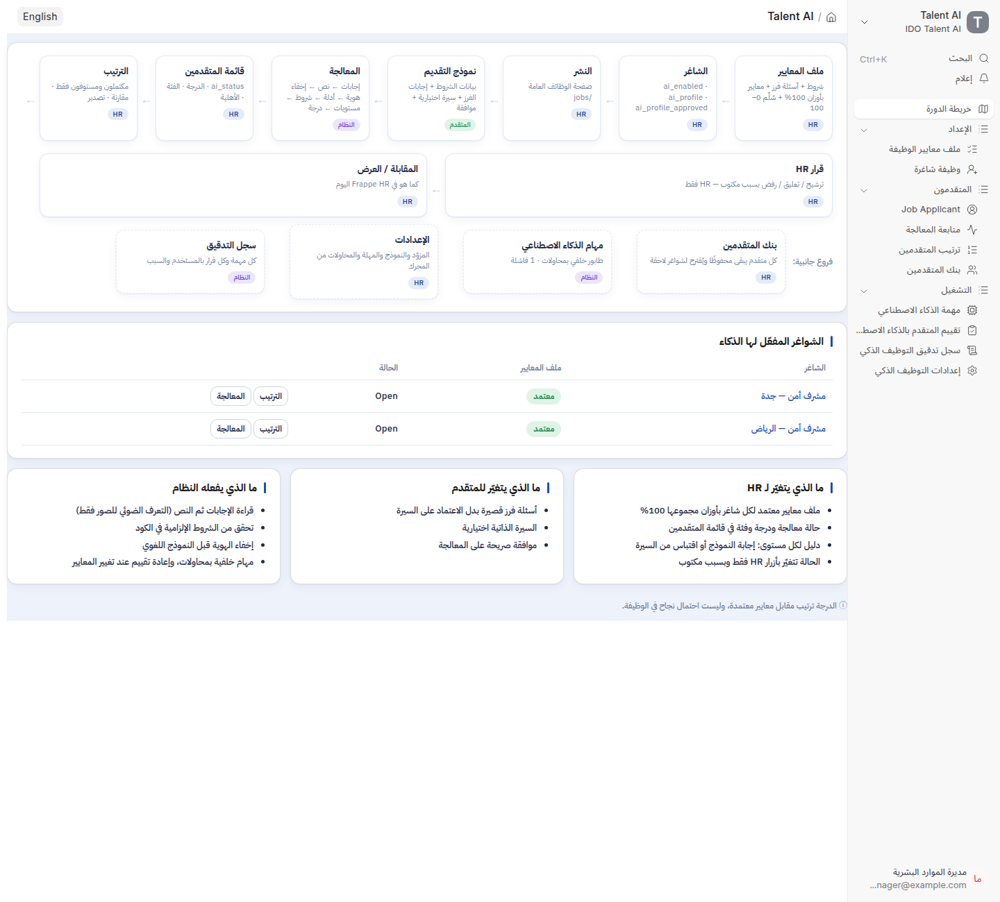

## 1) ملف المعايير — AI Job Profile

- من الخريطة اضغطي «ملف المعايير»، أو افتحي الشاغر «مشرف أمن — الرياض» واضغطي
  Talent AI ← ملف المعايير
- هتلاقي فوق مؤشر «مجموع الأوزان» (لازم 100%) وجدول النسخ المعتمدة (v1).
- تحت فيه المعايير بأوزانها 30/20/15/15/8/7/5، وكل معيار جواه وصف لكل مستوى 0/25/50/75/100.
- بعدها الشروط الإلزامية (الجنسية، الطول، الوزن، العمر) مكتوبة كجُمل عربي.
- وبعدها أسئلة الفرز اللي بتظهر في فورم التقديم.
- الزراير تحت Talent AI:
  «اقتراح معايير AI» (بيعمل مسودة بس، مش بيتستخدم غير بعد ما تعتمديه)
  «نسخ من قالب المسمى الوظيفي» (الملف ده نفسه اتنسخ من «قالب مشرف أمن»)

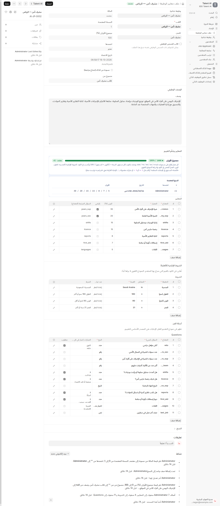

### تكملة 1: سُلّم التقييم والأوزان ومعاينة الأثر

- جرّبي: غيّري وزن «إدارة الورديات» من 15 لـ 20 من غير ما تغيّري حاجة تانية.
- المجموع يبقى 105% باللون الأحمر، ولو دوستي «اعتماد» السيرفر هيرفض.

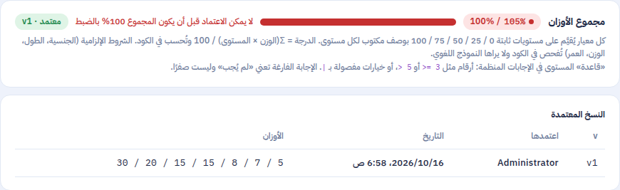

- رجّعي المجموع 100 (مثلًا «رخصة حارس أمن» من 15 لـ 10) واضغطي
  Talent AI ← معاينة الأثر
- هيطلعلك جدول: درجة كل متقدم قبل وبعد، والفئة، والترتيب، ومين اتحرك.
- لو اعتمدتي: بتتعمل نسخة v2، وكل النتائج القديمة تبقى «قديمة» لحد ما تعملي «إعادة تقييم الكل».

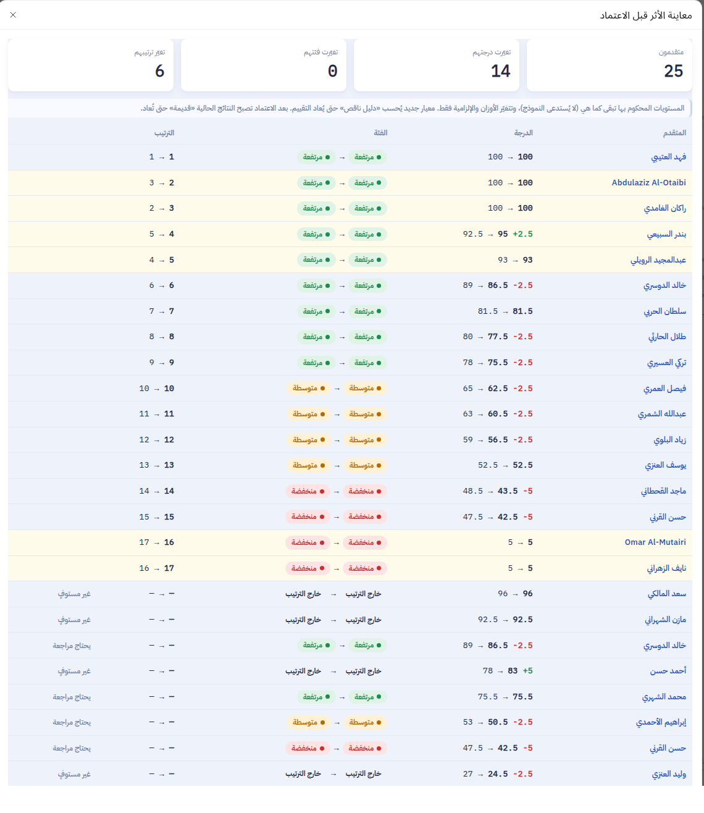

## 2) الشاغر — Job Opening

- افتحي الشاغر «مشرف أمن — الرياض» (HR-OPN-2026-0001).
- في قسم Talent AI:
  «AI screening enabled» مفعّل
  «AI Job Profile» مربوط
  «AI profile approved» بيتعلّم لوحده لما الملف يتعتمد
- وتحت فيه رابط التقديم العام للشاغر.

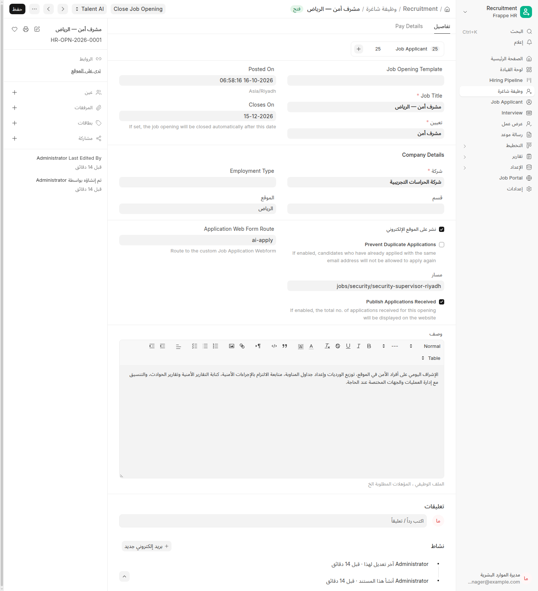

## 3) النشر — صفحة الوظائف

- افتحي في نافذة خاصة (من غير تسجيل دخول):
  `http://100.85.37.127:18050/jobs`
- اللغة بتمشي على لغة المتصفح (ده سلوك Frappe العادي). لو المتصفح إنجليزي ضيفي في آخر الرابط:
  `?_lang=ar`

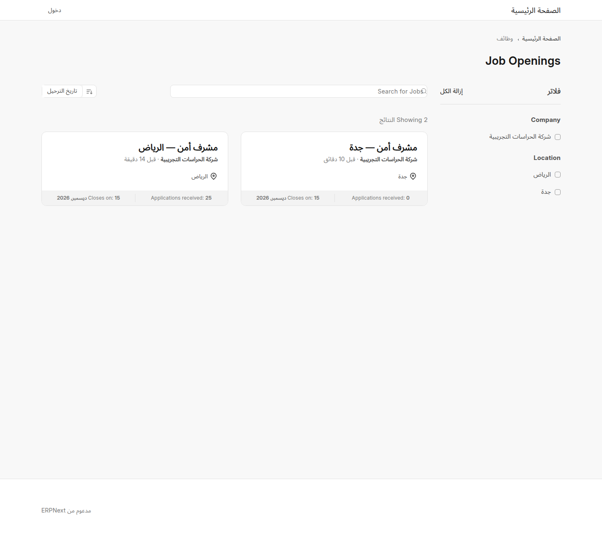

## 4) صفحة الوظيفة

- اضغطي على «مشرف أمن — الرياض».
- هتلاقي الوصف، وتحته مربع «شروط التقديم» بالعربي وعدد الأسئلة.
- زرار «التطبيق الآن» بيوديكي على فورم Talent AI مباشرة.

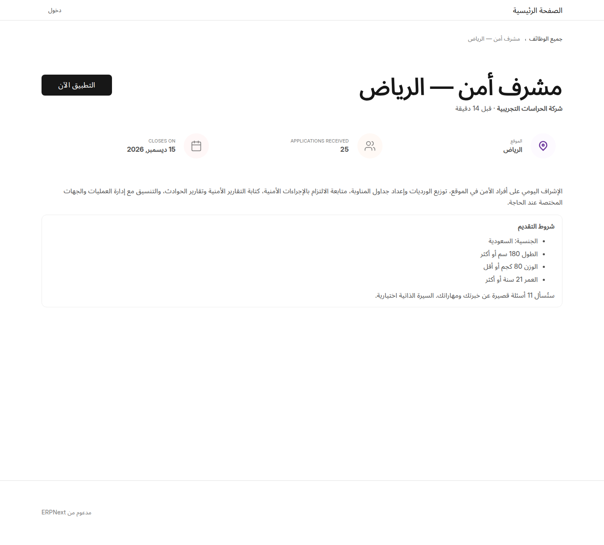

## 5) نموذج التقديم

- الفورم عربي من اليمين للشمال، وفيه زرار English فوق.
- بيسأل: بياناتك، الجنسية، نوع ورقم الهوية، تاريخ الميلاد.
- الطول والوزن بيظهروا بس لأن الشاغر ده عليه شرط طول ووزن.
- رقم الهوية مكتوب تحته إنه مش بيروح لخدمة الذكاء، بيستخدم بس لكشف التكرار.
- السيرة الذاتية اختيارية (PDF أو Word أو صورة)، والموافقة على المعالجة إلزامية.

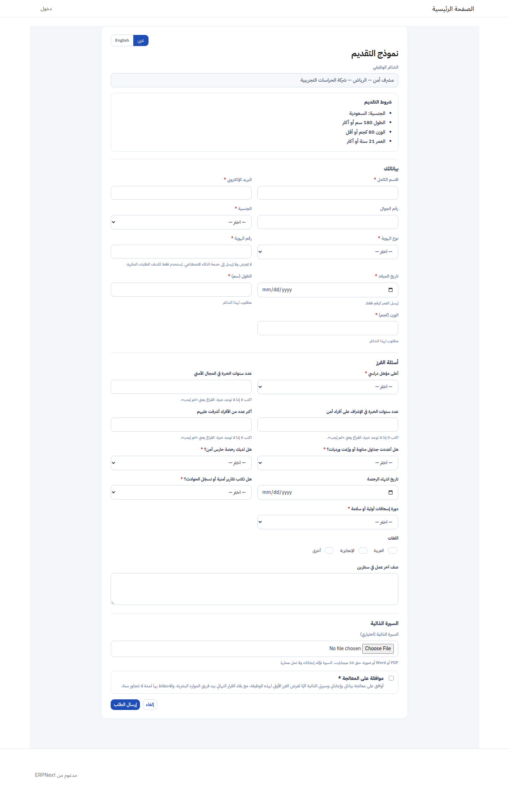

### تكملة 5: أسئلة الفرز

- الأسئلة جاية من ملف المعايير المعتمد.
- تحت كل سؤال رقمي مكتوب: «اكتب 0 إذا لا توجد خبرة. الفراغ يعني «لم يُجب».»
- جرّبي تقدّمي بنفسك: سيبي سؤال فاضي واكتبي 0 في سؤال تاني، وبعدين شوفي المتقدم من جوه:
  الفاضي هيبان «لم يُجب»، والـ 0 إجابة حقيقية.

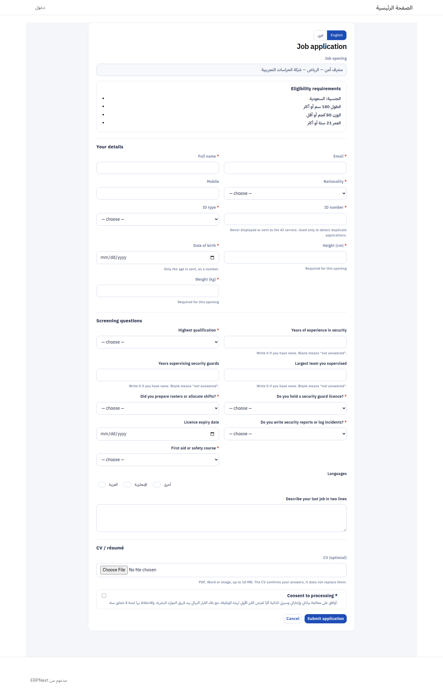

## 6) المعالجة — المراحل العشرة

- أول ما المتقدم يدوس «إرسال»، الطلب بيتحفظ فورًا (حتى لو المحرك واقف).
- افتحي المتقدم من جوه: هتلاقي «حالة المعالجة» = جاري المعالجة، وبتتغير لوحدها لـ مكتمل أو يحتاج مراجعة من غير ما تعملي refresh.
- في قسم «مراحل المعالجة» العشر مراحل بوقت كل واحدة: استلام، قراءة الإجابات، استخراج النص، إخفاء الهوية، الملف المنظّم، التحقق من الأدلة، الشروط، الحكم، الدرجة، الفهرسة.

- زرار «تحليل السيرة» بيفتح: الملف الأصلي، ومربع على كل سطر بلون الثقة (أخضر/أصفر/أحمر)، والنص المستخرج، وقبل وبعد إخفاء الهوية.
- اضغطي على أي دليل تحت «أدلة السيرة» يتظلل في النص وعلى الصورة.
- سيرة ممسوحة (صورة) — سلطان الحربي:

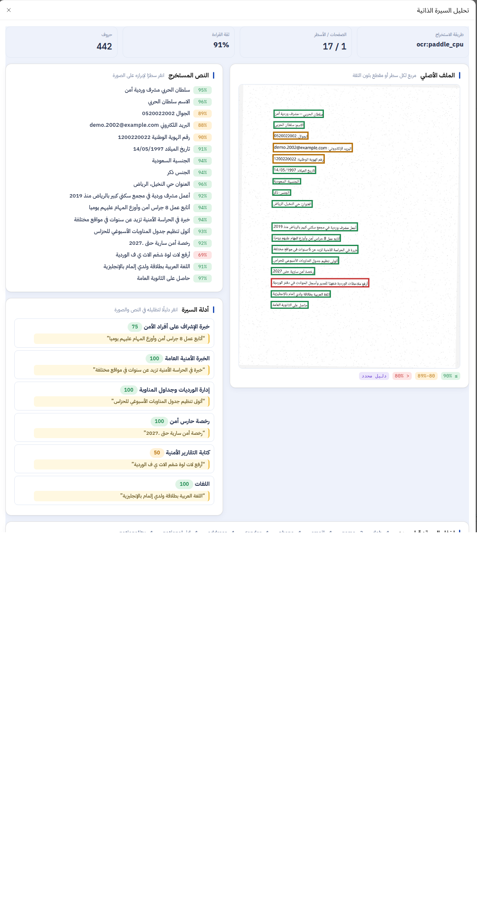

- سيرة PDF — فهد العتيبي:

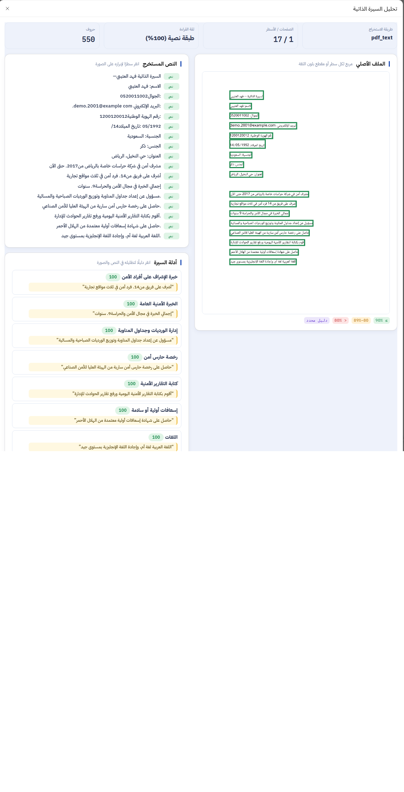

## 7) دفعة الألف — متابعة المعالجة

- افتحي «متابعة المعالجة» واختاري الشاغر.
- الأرقام حقيقية من الطلبات ومهام الذكاء: كل الطلبات، جاري، مكتمل، يحتاج مراجعة، فشل، والوقت المتوقع.
- بتتحدث لوحدها.

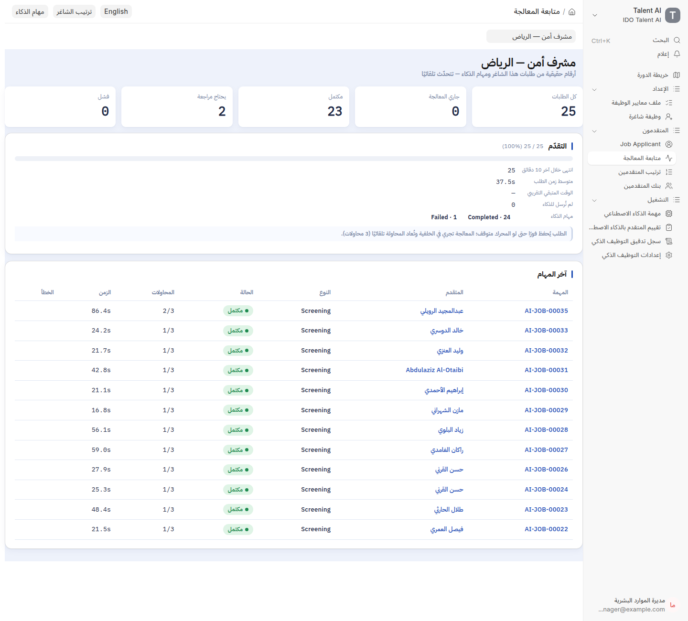

## 8) قائمة المتقدمين

- Job Applicant ← فلتر الشاغر.
- أعمدة جديدة: حالة المعالجة، والدرجة مع الفئة والترتيب.
- لو المتقدم برا الترتيب بيبان السبب: «غير مستوفٍ» أو «مكرر» أو «قديم».
- فلاتر فوق: حالة المعالجة، الفئة، الأهلية، النتيجة قديمة.
- وفيه جملة «الدرجة ترتيب مقابل معايير معتمدة، وليست احتمال نجاح في الوظيفة» فوق الجدول.

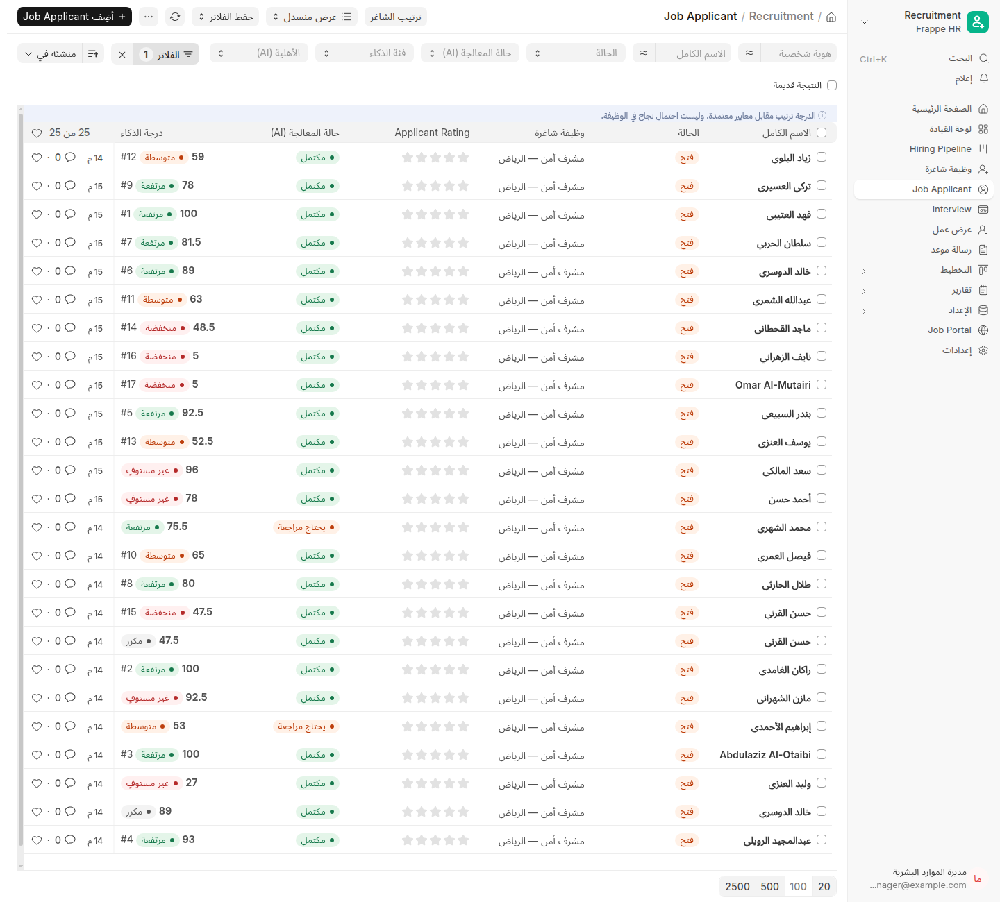

## 9) شاشة المتقدم

- افتحي سلطان الحربي (applicant.2002).
- قسم «تقييم الذكاء الاصطناعي»: الأهلية وأسبابها، الدرجة، التغطية، الترتيب، والملخص.
- جدول المعايير: المستوى ووصفه، والدليل لكل معيار:
  «إجابة النموذج» = من الفورم
  «من السيرة» = اقتباس من السيرة
  «تؤكده السيرة» = الإجابة والسيرة متفقين
- زرار «إلغاء الحكم» على كل معيار، والسبب إلزامي.
- تحت خالص: قرار الموارد البشرية (ترشيح للمقابلة / تعليق / رفض).

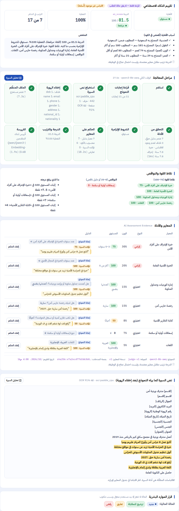

- أي قرار بيطلب سبب، وبيتسجل مين اللي قرر وإمتى. الذكاء نفسه عمره ما بيغيّر الحالة.
- (زراير HRMS العادية «Reject / Shortlist» اللي من غير سبب مستخبية في الشاشة دي.)

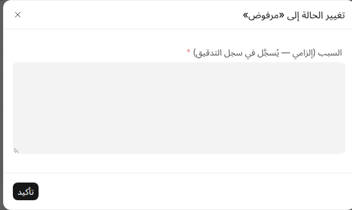

### تكملة 9 أ: نقاط القوة والنواقص وما يرفع الدرجة

- موجودة في نفس الشاشة: نقاط القوة (75–100)، النواقص (0–25 أو دليل ناقص)، و«ما الذي يرفع درجته» بعدد النقاط بالظبط.

### تكملة 9 ب: التعارض بين الإجابة والسيرة

- افتحي محمد الشهري (applicant.2012): كتب في الفورم 6 سنين إشراف، والسيرة بتقول «لمدة سنتين».
- الاتنين ظاهرين جنب بعض، بيتاخد المستوى الأقل، والطلب «يحتاج مراجعة».

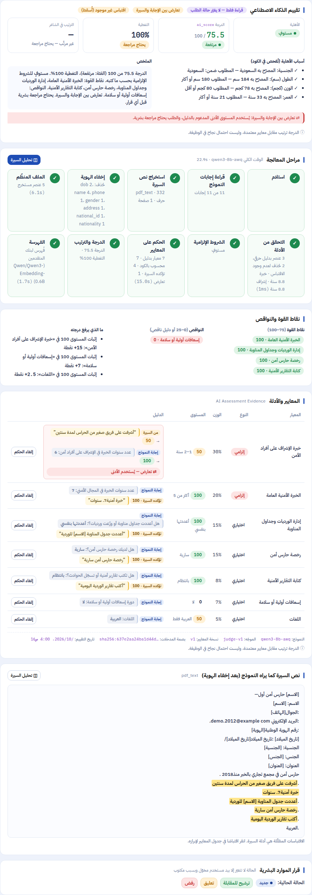

### تكملة 9 ج: الطلب المكرر

- افتحي حسن القرني التاني (hassan.q.second): نفس رقم الهوية (بصمة مشفّرة) زي applicant.2015.
- بيظهر رابط للطلب الأصلي، ومش بيترتب، ومفيش حاجة بتتمسح.

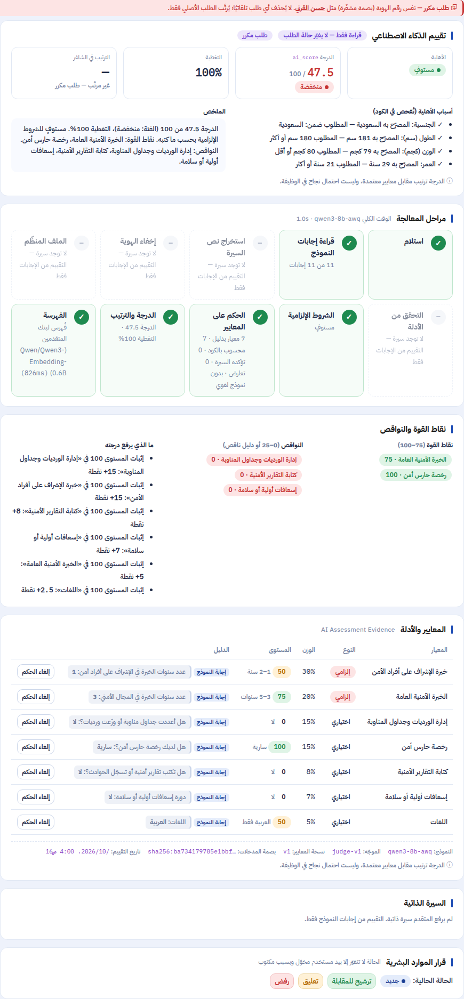

### تكملة 9 د: النتائج القديمة وإعادة التقييم

- جرّبي: افتحي أي متقدم، غيّري إجابة في «إجابات الفرز» واحفظي.
- هيظهر شريط «النتيجة لا تعكس آخر تعديل»، والمتقدم يطلع من الترتيب لمجموعة «قديم».
- زرار «إعادة التقييم» يرجّعه (ولو كذا متقدم: «إعادة تقييم القديم والفاشل» في صفحة الترتيب).

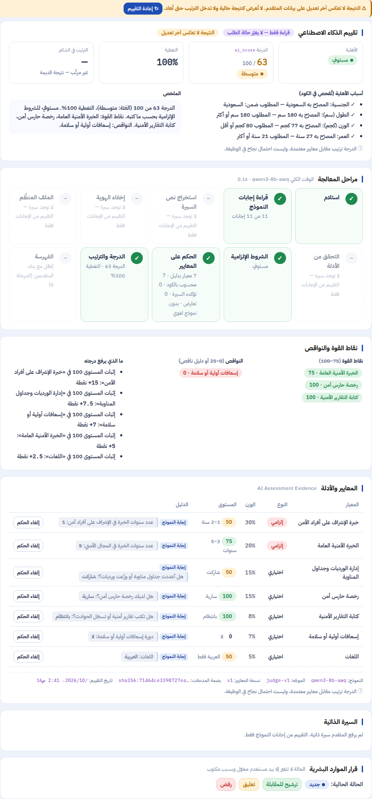

### حالات تانية في الديمو

- غير مستوفٍ (طول 172) — سعد المالكي applicant.2010:

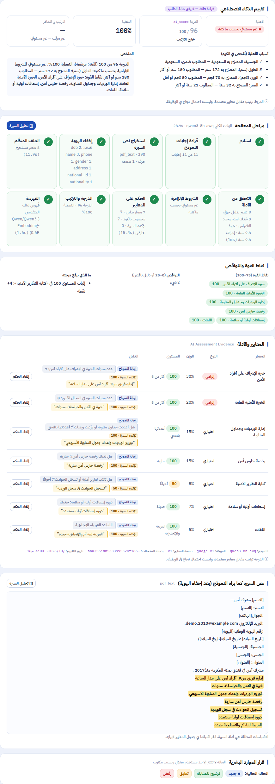

- سيرة تالفة — فيصل العمري applicant.2013: الطلب اتحفظ، والتقييم من الإجابات بس:

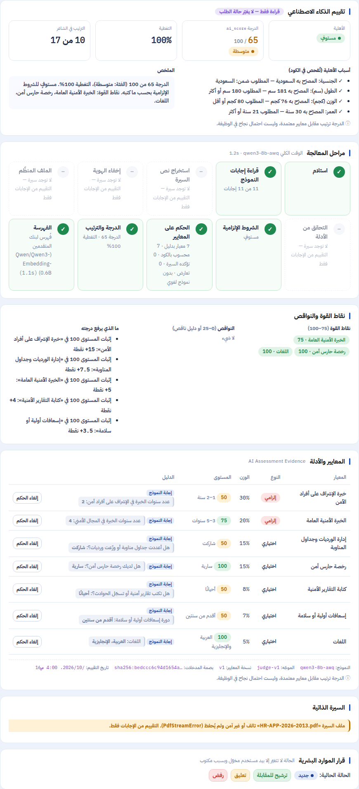

## 10) الترتيب

- افتحي «ترتيب المتقدمين» واختاري الشاغر.
- المرتّبين بس المكتملين والمستوفين، من الأعلى للأقل.
- تحتهم مجموعات مقفولة بالسبب: غير مستوفين، يحتاج مراجعة، جاري، فشل، قديم، مكرر.
- على الشمال الأوزان المعتمدة وطريقة الحساب.

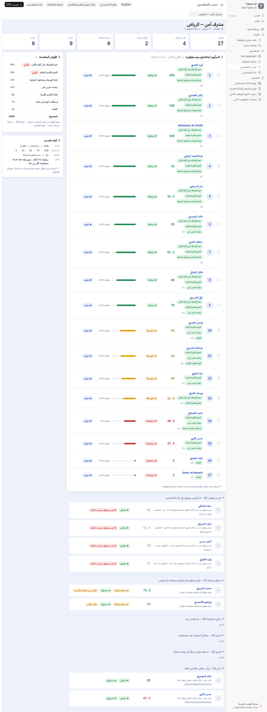

### تكملة 10: تصدير القائمة

- زرار «تصدير CSV» فوق: الملف بيفتح عربي صح في Excel.

### المقارنة (الميزة 10)

- علّمي على 2 أو 3 من المرتّبين واضغطي «مقارنة المحددين».
- مقارنة معيار بمعيار بنفس الأدلة، والأعلى في كل معيار متظلل.

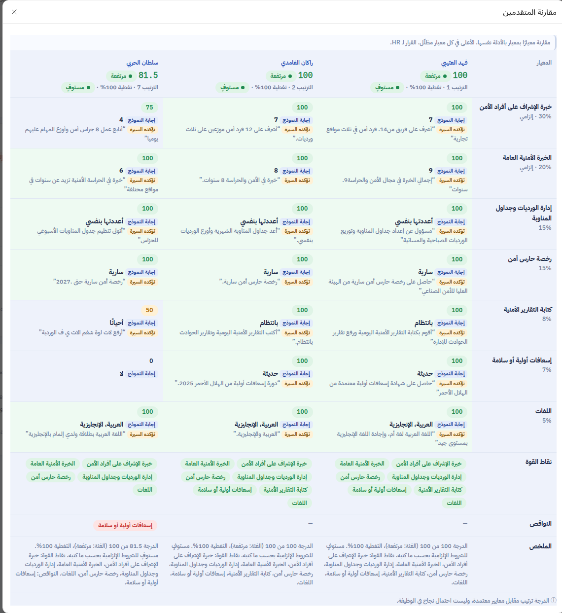

## 11) بنك المتقدمين (الميزة 13)

- افتحي «بنك المتقدمين» واختاري الشاغر الجديد «مشرف أمن — جدة»، واضغطي «بحث في بنك المتقدمين».
- الشروط الإلزامية بتتفحص الأول في الكود، وبعدين المستوفين بيترتبوا بنسبة التشابه.
- كل مقترح بيبان معاه الشاغر اللي اتقدم له قبل كده ودرجته هناك.
- المستبعدين تحت بالسبب:
  طلال الحارثي ← سحب موافقته (اتعملت بزرار «سحب موافقة المعالجة» في صفحته)
  زياد البلوي ← انتهت مدة الاحتفاظ ببياناته (طلب قديم من 2024 للتجربة)
  غير المستوفين ← مكتوب الشرط اللي فشل فيه
- ده اقتراح بس: مفيش حد بيتنقل ولا حالة بتتغير.
- نموذج التشابه شغال على الـ CPU (Qwen3-Embedding-0.6B)، ومش بياخد أي حاجة من كارت الشاشة.

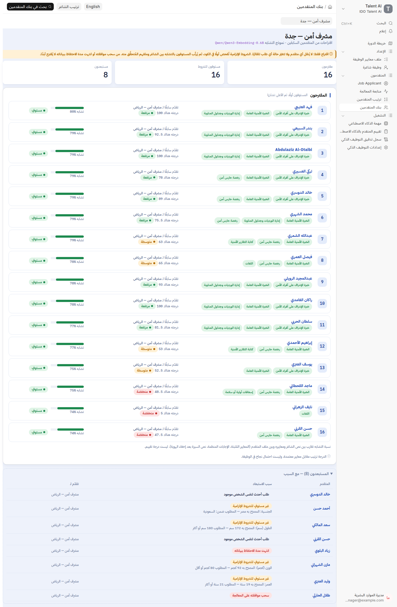

## 12) مهام الذكاء — AI Recruitment Job

- كل طلب ليه مهمة: النوع، الحالة، المحاولات، والخطأ لو حصل.

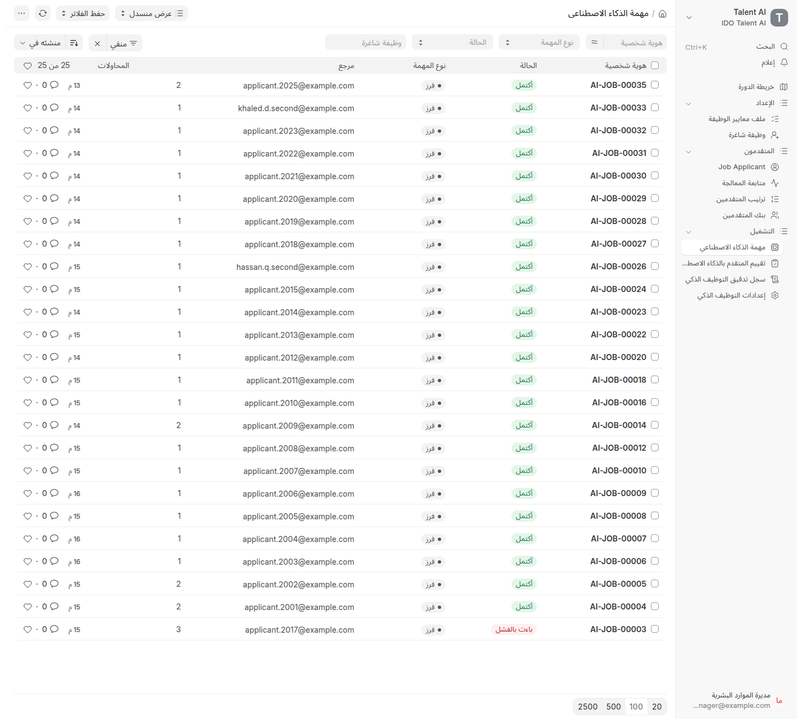

### تكملة 12: الفشل وإعادة المحاولة

- لما وقّفنا المحرك عن قصد: الطلب اتحفظ عادي، المهمة حاولت 3 مرات وبعدين «فشل» برسالة واضحة.
- لما المحرك رجع: زرار «إعادة المحاولة» كمّلها لـ «مكتمل».

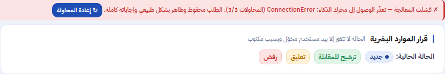
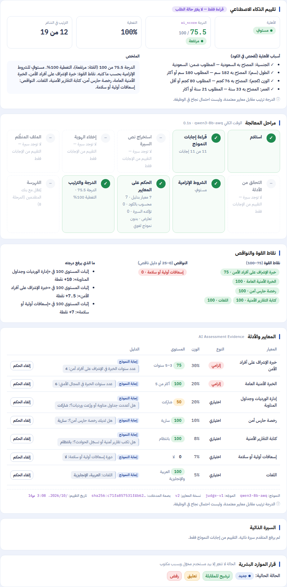

## 13) الإعدادات — AI Recruitment Settings

- عنوان المحرك ومفتاحه، رابط النتيجة وسرّه، والحقائق المسموح تتبعت.
- المزوّد والنموذج والـ OCR والمهلة وعدد المحاولات بتتقري من المحرك وتتكتب فيه.
- لوحة «حالة المحرك» بتقول إذا كان كل حاجة جاهزة.

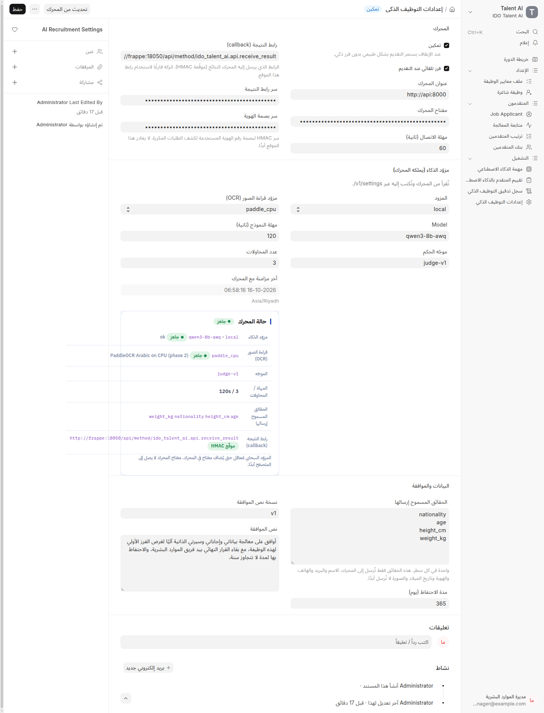

## 14) سجل التدقيق

- كل مهمة، وكل قرار، وكل تعديل حكم، وكل اعتماد معايير، بالمستخدم والسبب ونسخة المعايير.
- السجل للقراية بس.

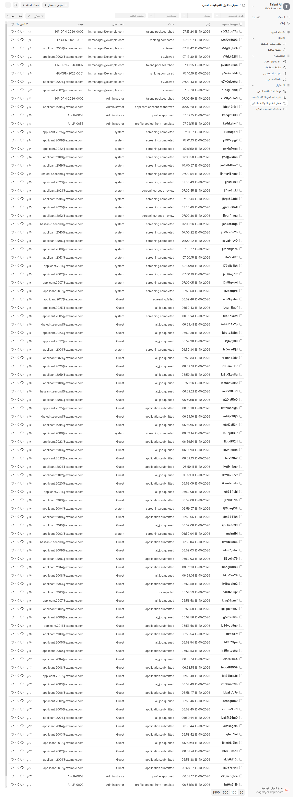

## 15) اختبارات القبول

- التفاصيل في `docs/ACCEPTANCE_REPORT.md`: 13 من 13 نجحوا، والصور في `docs/screenshots/acceptance/`.
- A7 (المقابلات والعروض) مؤجّل زي ما اتفقنا.

---

## حاجات مهمة تعرفيها

- قاعدة بيانات Frappe بتاعة التجربة شغالة في الذاكرة (القرص بطيء جدًا)، وفيه نسخة احتياطية كل ساعتين بترجع لوحدها لو الكونتينر اتعمله restart. لو حصلت مشكلة: `dev-frappe/reset_demo.sh`.
- اختبارات القبول بتغيّر الديمو، فبعدها اعملي reset.
- الأسئلة المفتوحة (منها اللي محتاج قرارك) في `docs/OPEN_QUESTIONS.md` من رقم 14 لـ 19.
