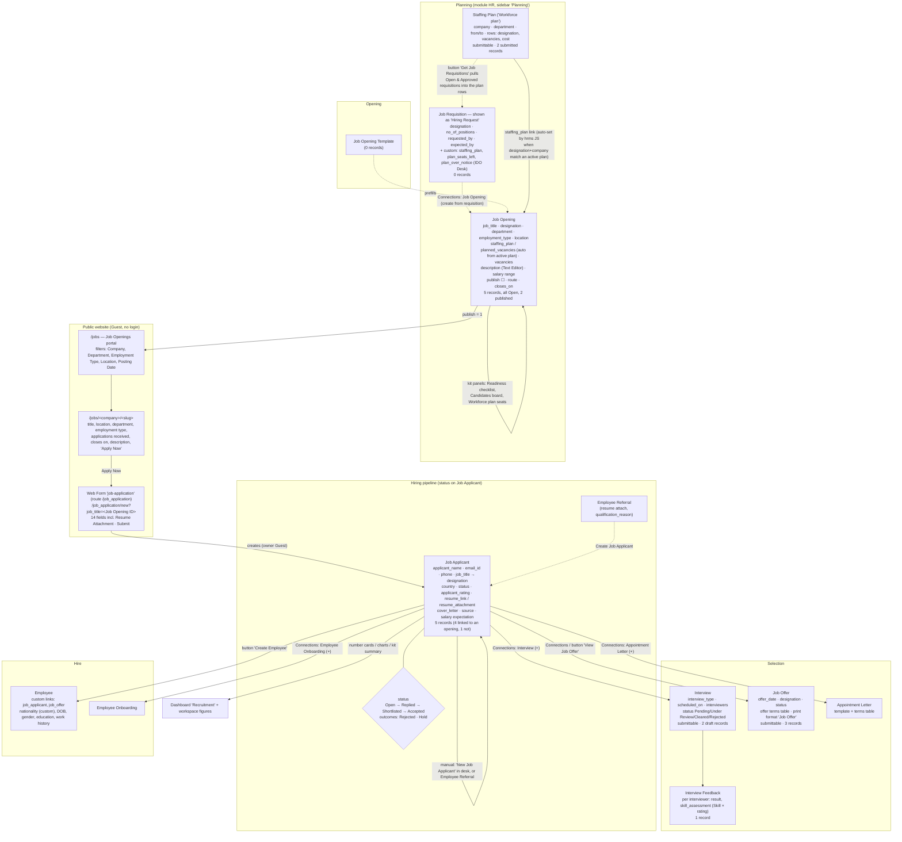

# 05 — Relationships and business flow

## Entity relationships (Link / Table fields, from DocType metadata)

```mermaid
erDiagram
    COMPANY ||--o{ STAFFING_PLAN : company
    DEPARTMENT ||--o{ STAFFING_PLAN : department
    STAFFING_PLAN ||--|{ STAFFING_PLAN_DETAIL : staffing_details
    DESIGNATION ||--o{ STAFFING_PLAN_DETAIL : designation
    DESIGNATION ||--o{ DESIGNATION_SKILL : "skills (custom field)"
    SKILL ||--o{ DESIGNATION_SKILL : skill

    DESIGNATION ||--o{ JOB_REQUISITION : designation
    STAFFING_PLAN ||--o{ JOB_REQUISITION : "staffing_plan (custom, IDO Desk)"
    DEPARTMENT ||--o{ JOB_REQUISITION : department
    EMPLOYEE ||--o{ JOB_REQUISITION : requested_by
    COMPANY ||--o{ JOB_REQUISITION : company

    JOB_OPENING_TEMPLATE ||--o{ JOB_OPENING : job_opening_template
    JOB_REQUISITION ||--o{ JOB_OPENING : job_requisition
    STAFFING_PLAN ||--o{ JOB_OPENING : staffing_plan
    DESIGNATION ||--o{ JOB_OPENING : designation
    DEPARTMENT ||--o{ JOB_OPENING : department
    EMPLOYMENT_TYPE ||--o{ JOB_OPENING : employment_type
    BRANCH ||--o{ JOB_OPENING : location
    COMPANY ||--o{ JOB_OPENING : company
    CURRENCY ||--o{ JOB_OPENING : currency

    JOB_OPENING ||--o{ JOB_APPLICANT : "job_title (optional)"
    DESIGNATION ||--o{ JOB_APPLICANT : "designation (fetched)"
    COUNTRY ||--o{ JOB_APPLICANT : country
    JOB_APPLICANT_SOURCE ||--o{ JOB_APPLICANT : source
    EMPLOYEE ||--o{ JOB_APPLICANT : "source_name (referrer)"
    EMPLOYEE_REFERRAL ||--o{ JOB_APPLICANT : employee_referral
    FILE }o--o| JOB_APPLICANT : "resume_attachment / sidebar attachments"

    JOB_APPLICANT ||--o{ INTERVIEW : job_applicant
    JOB_OPENING ||--o{ INTERVIEW : "job_opening (fetched)"
    INTERVIEW_TYPE ||--o{ INTERVIEW : interview_type
    INTERVIEW ||--o{ INTERVIEW_DETAIL : interview_details
    USER ||--o{ INTERVIEW_DETAIL : interviewer
    INTERVIEW_TYPE ||--o{ INTERVIEWER : interviewers
    INTERVIEW_TYPE ||--o{ EXPECTED_SKILL_SET : expected_skill_set
    SKILL ||--o{ EXPECTED_SKILL_SET : skill

    INTERVIEW ||--o{ INTERVIEW_FEEDBACK : interview
    JOB_APPLICANT ||--o{ INTERVIEW_FEEDBACK : "job_applicant (fetched)"
    USER ||--o{ INTERVIEW_FEEDBACK : interviewer
    INTERVIEW_FEEDBACK ||--o{ SKILL_ASSESSMENT : skill_assessment
    SKILL ||--o{ SKILL_ASSESSMENT : skill

    JOB_APPLICANT ||--o{ JOB_OFFER : job_applicant
    DESIGNATION ||--o{ JOB_OFFER : "designation (fetched)"
    JOB_OFFER_TERM_TEMPLATE ||--o{ JOB_OFFER : job_offer_term_template
    JOB_OFFER ||--o{ JOB_OFFER_TERM : offer_terms
    OFFER_TERM ||--o{ JOB_OFFER_TERM : offer_term
    TERMS_AND_CONDITIONS ||--o{ JOB_OFFER : select_terms

    JOB_APPLICANT ||--o{ APPOINTMENT_LETTER : job_applicant
    APPOINTMENT_LETTER_TEMPLATE ||--o{ APPOINTMENT_LETTER : appointment_letter_template
    APPOINTMENT_LETTER ||--o{ APPOINTMENT_LETTER_CONTENT : terms

    EMPLOYEE ||--o{ EMPLOYEE_REFERRAL : referrer
    DESIGNATION ||--o{ EMPLOYEE_REFERRAL : for_designation

    JOB_APPLICANT ||--o| EMPLOYEE : "Employee.job_applicant (custom field)"
    JOB_OFFER ||--o| EMPLOYEE : "Employee.job_offer (custom field)"
    JOB_APPLICANT ||--o{ EMPLOYEE_ONBOARDING : job_applicant
```

Notes on cardinality and keys:

- `Job Applicant.job_title` is **optional** (not reqd) → applicants without an opening are allowed (talent pool). 1 of 5 records has no opening.
- `Job Applicant` is currently **named by e-mail address** on the 5 existing records (legacy naming), while the DocType now declares `HR-APP-.YYYY.-.#####`. New records will get the series. There is no unique constraint on `email_id`; `Job Opening.prevent_duplicate_applicant` (0 on all openings) is the only duplicate guard, and it works per opening.
- `Job Opening.vacancies` is fetched from `job_requisition.no_of_positions` by default; the client's property setters made it editable / not required and only read-only when a requisition is linked.
- `Interview.job_opening` and `Interview Feedback.job_applicant` are fetch-from fields, i.e. denormalised copies.
- `Designation.skills` (table of Skill) is a Custom Field (hrms-installed) — the only place "competencies per job" can be stored today; it has no rows on this site.

## Business flow as it actually works in the UI

### What creates what (buttons and links seen, nothing clicked)

| From | Control | Creates / opens | Evidence |
|---|---|---|---|
| Staffing Plan form | `get_job_requisitions` Button "Get Job Requisitions" | pulls Open & Approved Job Requisitions into `staffing_details` | field metadata, `31_staffing_plan_form.png` |
| Job Requisition | Connections "Job Opening" (`links`: Job Opening.job_requisition) | New Job Opening prefilled from the requisition | DocType links |
| Job Opening form | "Close Job Opening" custom button | sets status Closed | `21_job_opening_form.png` |
| Job Opening form | Connections "Job Applicant +" | New Job Applicant with job_title set | `21_job_opening_form.png` |
| Job Opening (`publish`=1) | website route `jobs/<company>/<slug>` | public page with "Apply Now" | `50_`, `51_` screenshots |
| Public job page | "Apply Now" → `/job_application/new?job_title=<ID>` | Web Form → Job Applicant | `52_` screenshot |
| Job Applicant form | "Create Employee" | Employee (standard hrms `make_employee` wrapper) | custom_buttons |
| Job Applicant form | "View Job Offer" (shown because an offer exists; otherwise "Create Job Offer") | Job Offer | custom_buttons |
| Job Applicant form | Connections: Employee, Employee Onboarding, Job Offer, Appointment Letter, Interview (each with +) | respective new document | `11_job_applicant_form_details.png` |
| Job Applicant list | Kanban View menu / sidebar "Hiring Pipeline" | custom Hiring pipeline page | `12_…png` |
| Interview | Connections: Interview Feedback | Interview Feedback | DocType links |

Workflow engine: **no Workflow record** exists for any recruitment DocType (15 workflows on the site, none on HR recruitment). Status changes are plain field edits (Select) or custom buttons.
